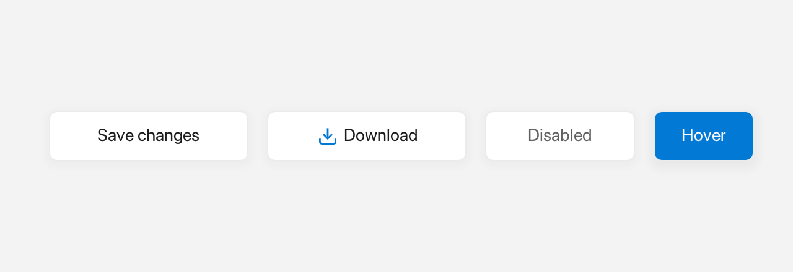

# Button

A `Button` is a clickable label that shows hover and pressed feedback and fires `onClick` when clicked with the mouse; there is no keyboard activation.



*Default, icon, disabled and hover states.*

## What it's for

Use a `Button` when you need an action the user can trigger. It displays text or `Inline` content (icons + colors) centered inside a rounded rectangle, handles hover and press automatically, and can host a dropdown `Menu` that opens below the button.

## The words you need

- **Callback** — a small function you give to the button so it can call you back when something happens. In C++ you usually write one as a lambda, like `[] { … }`.
- **`Inline`** — rich content that mixes text and icons. The `$()` shorthand builds it. See [Inline](inline.md) and [Icons](icons.md).
- **bounds** — where the button sits and how big it is, given as a `Rect`. See [Geometry & colors](geom.md).

In the examples below, `win` is an open window (see [Window](window.md)).

## A first example

```cpp
auto& btn = win.add<fluffy::Button>("Click me"); // bounds default to Rect{}
btn.setBounds(fluffy::Rect{40, 40, 120, 40});
btn.onClick([] { std::printf("clicked\n"); });
```

`win.add<fluffy::Button>(...)` creates the button with its label and returns a reference to it. Its bounds default to `Rect{}`, so you normally set them with `setBounds`. The `onClick` callback runs when the user presses and releases the mouse inside the button.

## Common tasks

### Change the label

Use `setLabel` for plain text, or `setInline` for rich content. `setText` is another name for `setInline`, so it takes an `Inline` too:

```cpp
btn.setLabel("Saving…");
std::string t = btn.label(); // plain label only; Inline content is write-only

btn.setInline(fluffy::$(fluffy::Icons::door_open << " Quit"));
btn.setText(fluffy::$(fluffy::Icons::check << " Done")); // another name for setInline
```

### Attach a dropdown menu

A button can own a vertical menu that opens below it:

```cpp
btn.setDropdownMenu(std::move(menu));
fluffy::Menu* m = btn.dropdownMenu();
bool hasMenu = btn.hasDropdownMenu();
```

When a dropdown menu is attached, clicking opens the menu below the button, and the button's typed `onClick` callback is not called. There is no YAML key for `dropdownMenu`; attach it in code. See [Menu](menu.md).

### Enable, disable, and inspect state

```cpp
btn.setEnabled(false);
bool hov = btn.isHovered(), pressed = btn.isPressed(), foc = btn.isFocused();
```

Setting `enabled` to `false` greys out the button and makes it ignore input.

### Bind a click handler

There are two ways to set the same handler:

```cpp
btn.onClick([] { std::printf("clicked\n"); });   // preferred
btn.setOnClick([&win] { win.requestClose(); });  // same setter, no chaining
```

`onClick` is the fluent alternative to `setOnClick`.

### Load a button from YAML

```yaml
Button:
  text: "Click me"
  x: 40
  y: 40
  width: 120
  height: 40
  onClick: "myHandler"
```

`onClick` works through the generic `setEvent` path, so any `onXxx` key binds a dispatcher handler.

## Good to know

- Clicking is mouse-only; there is no keyboard activation.
- `naturalWidth()` and `naturalHeight()` measure the label or inline content plus `button_padding_x/y`.

## Quick reference

### Properties

| Property | Type | Description |
|---|---|---|
| `label` | `string` | Plain button text. |
| `inline` | `Inline` | Rich label (`Icons::*`, `Color`, `Style`). Replaces `label`. |
| `enabled` | `bool` | `false` greys out and ignores input. |
| `dropdownMenu` | `unique_ptr<Menu>` | Optional vertical menu opened on click. |

Plus `Widget` properties: `bounds`, `visible`, `font`, `textSize`, `autoSize`, etc.

### Methods

```cpp
auto& btn = win.add<fluffy::Button>("Click me"); // bounds default to Rect{}
btn.setBounds(fluffy::Rect{40, 40, 120, 40});
btn.setLabel("Saving…");
std::string t = btn.label(); // plain label only; Inline content is write-only

btn.setInline(fluffy::$(fluffy::Icons::door_open << " Quit"));
btn.setText(fluffy::$(fluffy::Icons::check << " Done")); // another name for setInline

btn.setDropdownMenu(std::move(menu));
fluffy::Menu* m = btn.dropdownMenu();
bool hasMenu = btn.hasDropdownMenu();

btn.setEnabled(false);
bool hov = btn.isHovered(), pressed = btn.isPressed(), foc = btn.isFocused();
btn.onClick([] { /* ... */ }); // fluent alternative to setOnClick
```

### Events

| Event | Signature | When |
|---|---|---|
| `onClick` | `void()` | Mouse click (press + release inside). |

```cpp
btn.onClick([] { std::printf("clicked\n"); });   // preferred
btn.setOnClick([&win] { win.requestClose(); });  // same setter, no chaining
```

## See also

- [Label](label.md) — non-clickable.
- [Menu](menu.md) — dropdown implementation.
- [Inline](inline.md)
