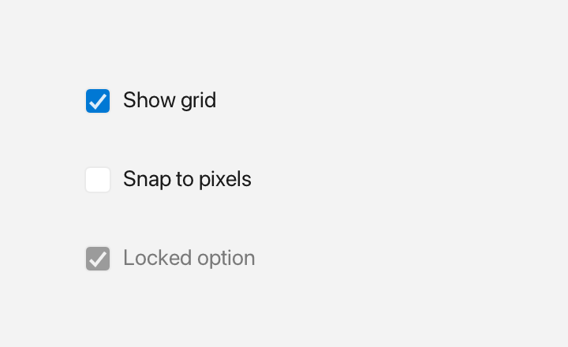

# Checkbox

A `Checkbox` is a square box with a text label that holds a boolean `checked` state.



*Checked, unchecked and disabled.*

## What it's for

A checkbox is an **on/off control**: it has exactly two states, checked and unchecked. Use it when the user is making a single choice that is independent of other controls — several checkboxes can be checked at the same time.

The checkbox shows a small square and a text label to its right. Clicking anywhere on the control toggles it. There is no keyboard activation yet.

Because the choice is independent, a checkbox is the right tool for things like "Enable notifications" or "Accept terms". If the user must choose exactly one option from a set, use a [RadioButton](radiobutton.md) instead.

You can also disable a checkbox so it is greyed out and ignores input.

## A first example

```cpp
#include <cstdio>

#include <fluffy/fluffy.hpp>

int main() {
    fluffy::Window win = fluffy::Window::open("Checkbox", 640, 400);
    if (!win) return 1;

    auto& cb = win.add<fluffy::Checkbox>(
        fluffy::Rect{40, 40, 180, 28}, "Enable notifications");
    cb.setChecked(true);

    bool on = cb.isChecked();
    std::printf("checked: %d\n", on);

    win.run();
}
```

`Window::open` creates the window, and `if (!win)` stops early if it could not be opened. `win.add<fluffy::Checkbox>()` creates the checkbox inside the window and returns a reference to it. The `auto&` matters: `cb` is that reference, so you work with the real checkbox rather than a copy.

The first constructor argument is a `Rect` that sets the position and size. The second is the text label. `setChecked(true)` turns the checkbox on, and `isChecked()` reads the current state.

## Common tasks

### Change the label

```cpp
cb.setLabel("Accept terms");
std::string t = cb.label();
```

`setLabel()` replaces the text to the right of the box, and `label()` returns the current text.

### Enable or disable the checkbox

```cpp
cb.setEnabled(false);
cb.setFocused(true);
```

When you pass `false` to `setEnabled()`, the checkbox is greyed out and no longer responds to input. `setFocused(true)` gives it keyboard focus, which shows a focus ring; it still does not toggle from the keyboard.

### React to changes

A **callback** is a function you give to a widget so it can call you back when something happens. `onChange` is the checkbox's callback for its state changing:

```cpp
cb.setOnChange([](bool checked) {
    std::printf("checked=%d\n", checked);
});
```

The callback runs when the user clicks the checkbox, and also when you call `setChecked()` yourself. It receives the new boolean value. `setChecked()` only calls the callback when the value actually changes, so setting the same state twice does nothing.

### Declare it in YAML

```yaml
Checkbox:
  label: "Enable notifications"
  checked: true
  x: 40
  y: 40
```

`label` is the text beside the box, `checked` is the initial state, and `x` / `y` place it. Add `width` and `height` when you want to set the size too.

## Quick reference

### Properties

| Property | Type | Description |
|---|---|---|
| `label` | `string` | Text to the right of the box. |
| `checked` | `bool` | Whether the box shows a checkmark. |
| `enabled` | `bool` | Inherited from `Widget`. |

### Events

| Event | Signature | When |
|---|---|---|
| `onChange` | `void(bool checked)` | Fires when `checked` changes — via click or programmatically via `setChecked()`. |

## See also

- [RadioButton](radiobutton.md) — exclusive choice.
- [Switch](switch.md) — pill toggle.
