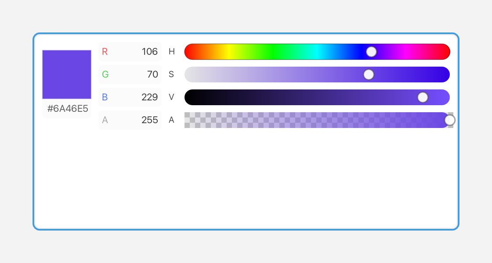

# ColorPicker

A `ColorPicker` lets you choose a `Color` through hue/saturation/value bars and editable RGBA/hex fields.



*HSV bars, RGBA fields and a preview swatch.*

## What it's for

A `Color` has four parts: red, green, blue, and alpha. Red, green, and blue mix to make the color; **alpha** is its opacity, where 0 is fully transparent and 255 is fully opaque. Fluffy stores each part as a byte from 0 to 255.

A color picker lets the user choose all four parts interactively. It shows four bars — hue, saturation, value, and alpha — along with editable `R/G/B/A` decimal fields and a `Hex` field. The bars and the fields stay in sync: change one and the others update.

The three color bars mean:

- **Hue** — the color family, such as red, yellow, green, or blue.
- **Saturation** — how strong the color is, from gray to vivid.
- **Value** — how bright the color is, from black to full brightness.

Use a color picker when the user should choose a color visually rather than type exact numbers.

## A first example

```cpp
#include <cstdio>

#include <fluffy/fluffy.hpp>

int main() {
    fluffy::Window win = fluffy::Window::open("ColorPicker", 640, 400);
    if (!win) return 1;

    auto& cp = win.add<fluffy::ColorPicker>(
        fluffy::Rect{40, 40, 280, 240},
        fluffy::Color::fromHex(0xFF8080FF));
    cp.setColor(fluffy::Color::fromHex(0xFF00FF00));

    fluffy::Color c = cp.color();

    win.run();
}
```

`Window::open` creates the window, and `if (!win)` stops early if it could not be opened. `win.add<fluffy::ColorPicker>()` creates the picker inside the window and returns a reference to it. The `auto&` matters: `cp` is that reference, so you work with the real picker rather than a copy.

The first constructor argument is a `Rect` that sets the position and size. The second is the initial `Color`.

`Color::fromHex()` takes a number written as `0xAARRGGBB`: alpha first, then red, green, and blue. For example, `0xFF8080FF` is an opaque pink, and `0xFF00FF00` is an opaque green. `setColor()` replaces the current color, and `color()` reads it back.

## Common tasks

### Edit the color

Click a field to edit it. `Enter` commits the value and `Esc` cancels. You can also drag the bars with the mouse. The widget keeps the bars, the fields, and the displayed color synchronized as you work.

### Disable or focus the picker

```cpp
cp.setEnabled(false);
bool f = cp.isFocused();
```

`setEnabled(false)` greys out the picker and makes it ignore input. The picker is focusable, and `isFocused()` reports the focus state. When it is focused it shows a focus ring.

### React to changes

A **callback** is a function you give to a widget so it can call you back when something happens. `onChange` is the picker's callback for its color changing:

```cpp
cp.setOnChange([](fluffy::Color c) {
    std::printf("#%02X%02X%02X%02X\n", c.r, c.g, c.b, c.a);
});
```

The callback runs when a bar is dragged or when the user successfully presses `Enter` in a text field. It receives the new `Color`. Its `r`, `g`, `b`, and `a` members are bytes, so you can print them or build your own output from them.

### Declare it in YAML

```yaml
ColorPicker:
  color: "#FF00FF80"
  x: 40
  y: 40
  width: 280
  height: 240
```

`color` is the initial color as a string. With eight digits the order is `#AARRGGBB`; with six digits, `#RRGGBB`, the color is opaque. `x`, `y`, `width`, and `height` set the geometry.

## Quick reference

### Properties

| Property | Type | Description |
|---|---|---|
| `color` | `Color` | Current `RGBA` value. |

### Events

| Event | Signature | When |
|---|---|---|
| `onChange` | `void(Color c)` | Bar drag or successful `Enter` in a text field. |

## See also

- `Color` in [Geom](geom.md)
