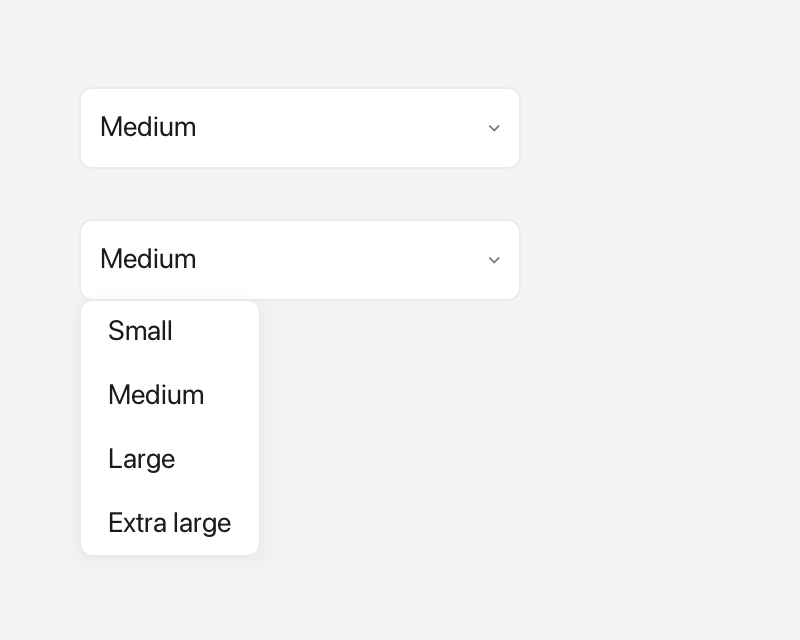

# ComboBox

A `ComboBox` is a dropdown field: it shows one choice at a time, and clicking it opens a short list of options to pick from.



*A closed selection and an open dropdown.*

---

## What it's for

Use a `ComboBox` when the user must choose exactly one option from a small,
fixed set and you want to save space. The field shows the current choice, or a
placeholder such as `"Pick one…"` when nothing is selected, with a small
chevron on the right. Clicking the field (or the chevron) opens a popup list;
picking an option closes it.

If the options should stay visible all the time, or there are many of them, use
a [ListView](listview.md) instead. If the data has several columns, use a
[Table](table.md).

---

## A first example

Here is a complete program. A window is the operating-system window your app
draws into; `Window::open` creates one, and `if (!win)` stops the program if the
window could not be opened. A widget is any visible element inside a window,
and `win.add<T>(...)` creates one and returns a reference to it. `Rect{x, y,
width, height}` says where the widget sits and how big it is. A callback is a
small function you hand to a widget so it can call you back when something
happens.

```cpp
#include <cstdio>

#include <fluffy/fluffy.hpp>

int main() {
    fluffy::Window win = fluffy::Window::open("ComboBox demo", 640, 400);
    if (!win) return 1;

    auto& cb = win.add<fluffy::ComboBox>(fluffy::Rect{40, 40, 240, 32});
    cb.setItems({"Apple", "Banana", "Cherry"});
    cb.setPlaceholder("Pick one…");
    cb.setSelectedIndex(1);
    cb.setOnChange([](int idx, const std::string& v) {
        std::printf("picked %d:%s\n", idx, v.c_str());
    });

    win.run();
}
```

`setItems` gives the field its options. `setPlaceholder` sets the text shown
while nothing is selected. `setSelectedIndex(1)` starts on "Banana": `0` is the
first option, `1` the second, and `-1` means no choice. `setOnChange` registers
a callback that receives the new index and the option text.

The snippets below assume `win` and `cb` from this example.

---

## Common tasks

### Using rich items

An `Inline` is rich text built from pieces: plain text, an icon from `Icons::*`,
and a `Color`. Use it when plain text is not enough. `setItemsInline` sets the
options this way, and setting either `items` or `itemsInline` updates the other.

```cpp
cb.setItemsInline({
    fluffy::Inline{} << fluffy::Icons::apple << " Apple",
    fluffy::Inline{} << fluffy::Color{200, 40, 40, 255} << fluffy::Icons::heart << " Cherry"
});
```

The placeholder has a rich form too. `setPlaceholderInline` pairs with
`setPlaceholder`, and setting one updates the other.

```cpp
cb.setPlaceholderInline(fluffy::Inline{} << fluffy::Icons::search << " Search");
```

### Reading the current selection

```cpp
int idx = cb.selectedIndex();
std::string v = cb.selectedValue();
fluffy::Inline inl = cb.selectedInline();
const auto& items = cb.items();
const auto& inlItems = cb.itemsInline();
const std::string& ph = cb.placeholder();
fluffy::Inline phInl = cb.placeholderInline();
```

`selectedIndex` and `selectedValue` give the plain form of the choice, while
`selectedInline` gives the rich form. The other getters return the option list
and the placeholder.

### Opening the popup yourself

```cpp
cb.openPopup(win);
```

This shows the dropdown without waiting for a click. You can also disable the
field with `setEnabled(false)`; a disabled field ignores input.

### Loading from YAML

Fluffy can also describe widgets in YAML, a plain text format. This entry
creates a `ComboBox` with the same options as above:

```yaml
ComboBox:
  items: ["Apple", "Banana", "Cherry"]
  selected: 1
  placeholder: "Pick one…"
  x: 40
  y: 40
  width: 240
```

`selected` accepts an index or a string value. `value` is an alias of
`selected`, and `options` is an alias of `items`. A string that matches no item
is silently ignored.

---

## Good to know

- When focused, `Space` or `Enter` opens the popup, and `Up`/`Down` moves through
  the items. `Up` at the first item and `Down` at the last do nothing; the list
  does not wrap around.
- `onChange` fires on a list pick, on `Up`/`Down`, or from `setSelectedIndex()`.
  Re-selecting the same index never fires. Out-of-range input becomes `-1`, and
  that fires only if it changes the selection.
- The field is focusable and shows an accent border when focused. There is no
  `focused()` getter; use `setFocused()` only.

---

## Quick reference

### Properties

| Property | Type | Description |
|---|---|---|
| `items` | `vector<string>` | Plain-text options. |
| `itemsInline` | `vector<Inline>` | Rich options (text + `Color` + `Icons::*`). Setting one updates the other. |
| `selectedIndex` | `int` | `-1` means none, otherwise `0..n-1`. |
| `selectedValue` / `selectedInline` | `string` / `Inline` | Plain and rich form of the current choice. |
| `placeholder` / `placeholderInline` | `string` / `Inline` | Shown when `selectedIndex == -1`. Setting one updates the other. |
| `focused` | — | Focusable; shows an accent border when focused (no `focused()` getter — use `setFocused()` only). |

### Methods

```cpp
auto& cb = win.add<fluffy::ComboBox>(fluffy::Rect{40, 40, 240, 32});
cb.setItems({"Apple", "Banana", "Cherry"});
cb.setItemsInline({
    fluffy::Inline{} << fluffy::Icons::apple << " Apple",
    fluffy::Inline{} << fluffy::Color{200, 40, 40, 255} << fluffy::Icons::heart << " Cherry"
});
cb.setPlaceholder("Pick one…");
cb.setPlaceholderInline(fluffy::Inline{} << fluffy::Icons::search << " Search");

cb.setSelectedIndex(1);
int idx = cb.selectedIndex();
std::string v = cb.selectedValue();
fluffy::Inline inl = cb.selectedInline();
const auto& items = cb.items();
const auto& inlItems = cb.itemsInline();
const std::string& ph = cb.placeholder();
fluffy::Inline phInl = cb.placeholderInline();

cb.openPopup(win);
cb.setEnabled(false);
```

### Events

| Event | Signature | When |
|---|---|---|
| `onChange` | `void(int index, const string& value)` | Fires when the selection changes — list pick, `Up`/`Down` keys, or `setSelectedIndex()`. Re-selecting the same index never fires; out-of-range input becomes `-1` (fires only if that changes the selection). |

```cpp
cb.setOnChange([](int idx, const std::string& v) {
    std::printf("picked %d:%s\n", idx, v.c_str());
});
```

---

## See also

- [ListView](listview.md) — scrollable list variant.
- [Menu](menu.md) — popup implementation.
- [Inline](inline.md) · [Icons](icons.md)
