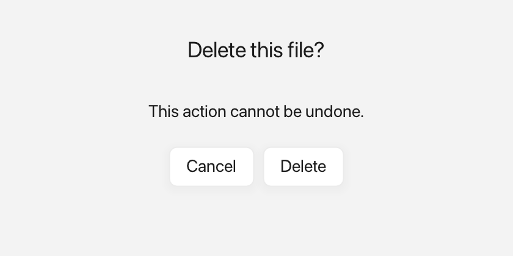

# Dialogs

A dialog is a small modal window that asks the user to make a decision. The
call that shows it waits until the user answers.



*A confirmation dialog with two buttons.*

---

## What it's for

Use a dialog when you need an answer before the rest of your code continues, such
as confirming a delete or asking whether to save changes. "Modal" means the
dialog sits in front of the main window and must be dealt with first.

Fluffy can show a dialog with preset buttons, with labels you supply, or with
rich `Inline` buttons and messages that include icons and colors. An `Inline` is
rich text built from plain text, an icon from `Icons::*`, and a `Color`.

`Window::showDialog` returns a typed `DialogChoice` that tells you which button
was clicked.

---

## A first example

A window is the operating-system window your app draws into. `Window::open`
creates it, and `if (!win)` stops the program if the window could not be opened.
`win.add<T>(...)` creates a widget inside that window and returns a
reference to it. `Rect{x, y, width, height}` places the widget. A callback is a
small function you give to a widget so it can call you back when something
happens.

```cpp
#include <cstdio>

#include <fluffy/fluffy.hpp>

int main() {
    fluffy::Window win = fluffy::Window::open("Dialog demo", 640, 400);
    if (!win) return 1;

    auto& btn = win.add<fluffy::Button>("Delete…");
    btn.setBounds(fluffy::Rect{40, 40, 140, 40});
    btn.onClick([&win] {
        auto answer = win.showDialog("Confirm", "Are you sure?", {"Yes", "No"});
        if (answer == fluffy::Window::DialogChoice::First) {
            std::printf("proceeding\n");
        }
    });

    win.run();
}
```

`showDialog` takes a title, a message, and a list of button labels. It waits
while the dialog is open, so the code after it runs only once the user answers.
`DialogChoice::First`, `Second`, and `Third` index the button list: `First`
means the user clicked "Yes" here. `DialogChoice::Dismissed` means the user
pressed Escape or closed the dialog without choosing.

The snippets below assume `win` from this example.

---

## Common tasks

### Use preset button sets

```cpp
auto answer = win.showDialog(
    "Delete file", "Delete report.txt?", fluffy::Window::DialogButtons::OkCancel);
```

The preset sets are `Ok`, `OkCancel`, `YesNo`, and `YesNoCancel`. The typed
answer indexes the preset's buttons in order: `First` is `OK` or `Yes`,
`Second` is `Cancel` or `No`, and `Third` is `Cancel` in the three-button set.
If the user dismisses the dialog with Escape or the close button, `showDialog`
returns `DialogChoice::Dismissed`.

### Provide custom button labels

```cpp
auto answer = win.showDialog(
    "Save changes?",
    fluffy::Inline{} << "You have unsaved edits.",
    std::vector<fluffy::Inline>{
        fluffy::Inline{} << "Save",
        fluffy::Inline{} << "Discard",
        fluffy::Inline{} << "Cancel"});
```

Use the `vector<Inline>` overload when you want your own labels. The third
argument supplies the buttons in order.

### Add icons to buttons

```cpp
auto answer = win.showDialog(
    "Confirm",
    "Erase everything?",
    std::vector<fluffy::Inline>{
        fluffy::$(fluffy::Icons::trash << " Erase"),
        fluffy::$(fluffy::Icons::x << " Cancel")
    });
```

`fluffy::$(...)` is a shorthand that starts an `Inline` stream, so
`fluffy::$(fluffy::Icons::trash << " Erase")` means "an icon followed by the
text ` Erase`". The answer is the button's position, so icons do not affect it.

### Show an icon with a colored message

```cpp
win.showDialog(
    "Warning",
    fluffy::$(fluffy::Icons::alert_triangle
             << " This cannot be undone."),
    std::vector<fluffy::Inline>{
        fluffy::$(fluffy::Icons::check << " Yes"),
        fluffy::$(fluffy::Icons::x << " No")
    });
```

The rich-message overload takes an `Inline` as the message, so you can compose
an icon and colored text for the body as well as for the buttons.

---

## Good to know

- The parent window cannot be closed while the dialog is open.
- Pressing Escape or the close button dismisses the dialog and returns
  `DialogChoice::Dismissed`.
- The call is blocking: code after `showDialog` runs only after the dialog
  closes.
- Dialogs have a fixed size of 380×180 pixels.
- On WebAssembly there is no second native window. Dialogs fall back to the
  browser's `alert` and `confirm`, and a dialog with three or more buttons
  returns `DialogChoice::First`.

---

## Quick reference

### `Window::showDialog`

Overloads: `(title, message, DialogButtons)`, `(title, message, vector<string>)`,
`(title, message, vector<Inline>)` and `(title, Inline, vector<Inline>)`.

Returns `DialogChoice::First` / `Second` / `Third` to index the button list;
`Dismissed` means Escape/close without choosing. Fixed at `380×180`.

### `Window::DialogButtons`

```cpp
fluffy::Window::DialogButtons::Ok;
fluffy::Window::DialogButtons::OkCancel;
fluffy::Window::DialogButtons::YesNo;
fluffy::Window::DialogButtons::YesNoCancel;
```

---

## See also

- [Window](window.md) — `showDialog` and window chrome.
- [Inline](inline.md) — composing message and button content.
- [Icons](icons.md) — icons in dialog buttons.
