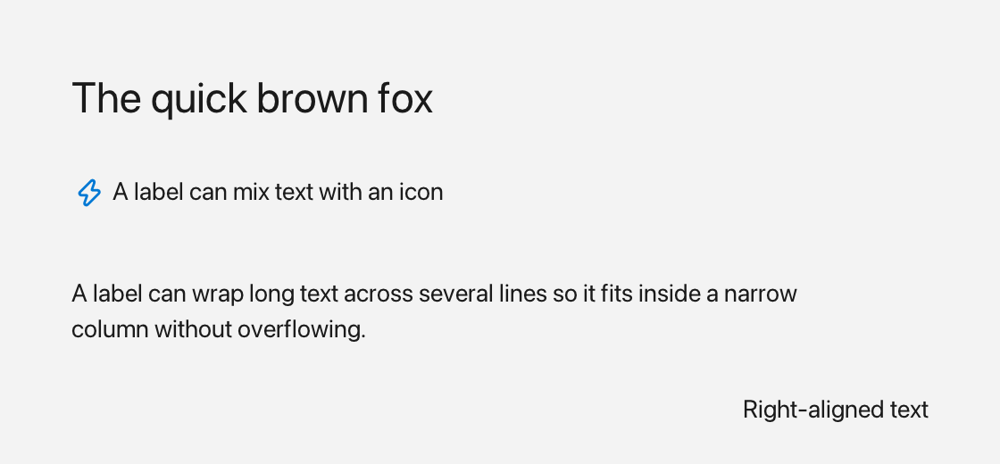

# Label

A `Label` displays static text, either as a plain string or as rich `Inline` content (text + icons + colors), and can optionally wrap at word boundaries.



*Regular, icon and wrapped text, plus a right-aligned line.*

## What it's for

Use a `Label` whenever you need read-only text inside a window. It renders its text inside its `Rect`, supports horizontal and vertical alignment, word wrap, and auto-sizing from content. Since a label never reacts to clicks, reach for a [Button](button.md) when you need something clickable.

## The words you need

- **`Inline`** — content made of one or more runs of text and icons. A label can show either a plain string or `Inline` content.
- **`$()`** — a shorthand that builds an `Inline` from the pieces you stream into it with `<<`. For example `fluffy::$(fluffy::Icons::rocket << " Launch")` puts an icon and the text " Launch" together. See [Inline](inline.md) and [Icons](icons.md).
- **bounds** — where the label sits and how big it is, given as a `Rect`. See [Geometry & colors](geom.md).

In the examples below, `win` is an open window (see [Window](window.md)).

## A first example

```cpp
auto& lbl = win.add<fluffy::Label>("Hello");
lbl.setBounds(fluffy::Rect{40, 40, 200, 32});
lbl.setText("New text");
std::string t = lbl.text();
```

`win.add<fluffy::Label>(...)` creates the label inside the window and returns a reference to it. `setBounds` places it, `setText` replaces the text, and `text()` returns the current plain text.

## Common tasks

### Show rich content with icons and colors

Use `setInline` to display `Inline` content made of `Color`, `Icons::*`, and `Style` values:

```cpp
lbl.setInline(fluffy::$(fluffy::Icons::rocket << " Launch")); // Inline content is write-only
```

Inline content is write-only, so read back the plain text with `text()` when you need a value.

### Align the text

Set the horizontal and vertical alignment independently. Both setters return `Label&`, so you can chain them:

```cpp
lbl.setHorizontal(fluffy::Label::Align::Center); // both return Label& (chainable)
lbl.setVertical(fluffy::Label::Align::Center);   // Center doubles as vertical middle
```

The vertical alignment reuses the same `Align` enum, where the values act as top/middle/bottom.

### Wrap text and auto-size the label

Word wrap is controlled with `setWordWrap`, and the current setting is available through `wordWrap`:

```cpp
lbl.setWordWrap(true);
bool w = lbl.wordWrap();
```

To let the label grow with its content, use `setAutoSize`:

```cpp
lbl.setAutoSize(fluffy::AutoSize::Both); // height grows to fit wrapped lines
```

`naturalWidth()` and `naturalHeight()` return the size needed for the current text or inline content. When `wordWrap` is on, the natural height accounts for the wrapped lines.

### Load a label from YAML

```yaml
Label:
  text: "Hello, World!"
  x: 40
  y: 40
  width: 200
  height: 32
  align: center
```

YAML alignment keys are `align` (sets both axes), `horizontal_align`, and `vertical_align`. There is no `word_wrap` key, so word wrap stays at its code default (`true`) for YAML-loaded labels. A `color` key is parsed but currently has no effect.

## Good to know

- Setting `text` clears any previous `Inline`; setting `inline` replaces `text`.
- `Label` does not fire user events. Use `Button` for clicks.
- All `Widget` properties also apply: `bounds`, `visible`, `enabled`, `font`, `textSize`, `autoSize`, and `userdata`.

## Quick reference

### Properties

| Property | Type | Description |
|---|---|---|
| `text` | `string` | Plain text. Setting it clears any previous `Inline`. |
| `inline` | `Inline` | Rich content (`Color` + `Icons::*` + `Style`). Setting it replaces `text`. |
| `align` / `horizontal` / `vertical` | `Align {Left,Center,Right}` | How text sits inside the rect (vertical reuses the same enum as top/middle/bottom). |
| `wordWrap` | `bool` | `true` wraps at word boundaries using the label width. Default `true`. |

### Methods

```cpp
auto& lbl = win.add<fluffy::Label>("Hello");
lbl.setBounds(fluffy::Rect{40, 40, 200, 32});
lbl.setText("New text");
std::string t = lbl.text();

lbl.setInline(fluffy::$(fluffy::Icons::rocket << " Launch")); // Inline content is write-only

lbl.setHorizontal(fluffy::Label::Align::Center); // both return Label& (chainable)
lbl.setVertical(fluffy::Label::Align::Center);   // Center doubles as vertical middle

lbl.setWordWrap(true);
bool w = lbl.wordWrap();

lbl.setAutoSize(fluffy::AutoSize::Both); // height grows to fit wrapped lines
```

### Events

`Label` does not fire user events. Use `Button` for clicks.

## See also

- [Button](button.md) — clickable label.
- [Inline](inline.md) · [Icons](icons.md)
- [Widget](widget.md)
