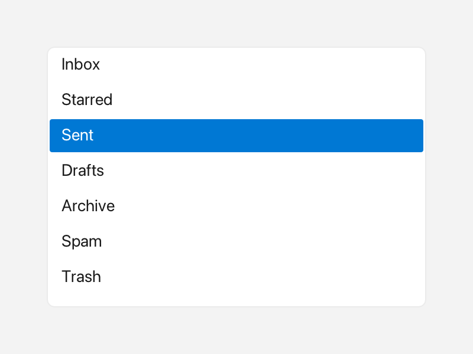

# ListView

A `ListView` is a scrollable vertical list where the user can select one row.
Each row is plain text or rich `Inline` content with icons and colors.



*A scrolling list with the third row selected.*

---

## What it's for

Use a `ListView` when you have a longer set of options or data rows and want the
user to pick one. Unlike a [ComboBox](combobox.md), the list stays open on the
screen instead of hiding behind a dropdown, so it suits side panels and pickers
where seeing the choices matters.

Rows have a fixed height and are clipped to the widget's `Rect`. When the
content overflows, a scrollbar appears and the mouse wheel scrolls the list.
Hovered rows are highlighted, and the selected row is painted with a solid
accent color and white text.

---

## A first example

A window is the operating-system window your app draws into. `Window::open`
creates it, and `if (!win)` stops the program if the window could not be opened.
`win.add<T>(...)` creates a widget inside that window and returns a
reference to it. `Rect{x, y, width, height}` places the widget. A callback is a
small function you give to a widget so it can call you back when something
happens.

```cpp
#include <cstdio>

#include <fluffy/fluffy.hpp>

int main() {
    fluffy::Window win = fluffy::Window::open("ListView demo", 640, 400);
    if (!win) return 1;

    auto& lv = win.add<fluffy::ListView>(fluffy::Rect{40, 40, 300, 160});
    lv.setItems({"Item 1", "Item 2", "Item 3"});
    lv.setSelected(1);
    lv.setOnSelect([](int idx, const std::string& v) {
        std::printf("selected %d:%s\n", idx, v.c_str());
    });

    win.run();
}
```

`setItems` fills the list, and `setSelected` chooses the starting row. An index
of `-1` means no selection. The `onSelect` callback receives the row index and
its value.

The snippets below assume `win` and `lv` from this example.

---

## Common tasks

### Using rich rows

An `Inline` is rich text made from plain text, an icon from `Icons::*`, and a
`Color`. `setItemsInline` lets each row carry that content. It mirrors `items`:
setting one form updates the other.

```cpp
lv.setItemsInline({
    fluffy::Inline{} << fluffy::Icons::star << " Star",
    fluffy::Inline{} << fluffy::Color{200, 40, 40, 255} << "Warning"
});
```

### Reading the selection

```cpp
int sel = lv.selected();
std::string v = lv.items()[sel];
fluffy::Inline inl = lv.selectedInline();
const auto& inlItems = lv.itemsInline();
```

`selected` returns the row index, or `-1` when nothing is selected.
`selectedInline` returns the rich form of the selected row. Check `sel` before
indexing `items()`.

### Disabling the list

```cpp
lv.setEnabled(false);
```

A disabled list is greyed out and ignores clicks and keys.

### Loading from YAML

Fluffy can also describe widgets in YAML, a plain text format:

```yaml
ListView:
  items: ["Item 1", "Item 2", "Item 3"]
  selected: 0
  x: 40
  y: 40
  width: 300
  height: 160
```

Unlike `ComboBox`, `selected` accepts an integer index only; there is no string
form.

---

## Good to know

- Replacing the items with `setItems` or `setItemsInline` resets the selection to
  `-1` when it falls out of range and resets the scroll position.
- An out-of-range `setSelected` becomes `-1`.
- `onSelect` fires on a row click, on `Up`/`Down`/`Home`/`End` when focused, or
  from `setSelected()` — whenever the index actually changes. Re-selecting the
  same row or clearing to `-1` never fires.
- The list is focusable and shows a focus halo. There is no `focused()` getter;
  use `setFocused()` only.

---

## Quick reference

### Properties

| Property | Type | Description |
|---|---|---|
| `items` | `vector<string>` | Plain-text rows. |
| `itemsInline` | `vector<Inline>` | Rich rows (`Icons::*`, `Color`). Mirrors `items`. |
| `selected` | `int` | `-1` none, otherwise selected row index (read via `selected()`). |
| `focused` | — | Focusable; shows a focus halo (no `focused()` getter — use `setFocused()` only). |

### Methods

```cpp
auto& lv = win.add<fluffy::ListView>(fluffy::Rect{40, 40, 300, 160});
lv.setItems({"Item 1", "Item 2", "Item 3"});
lv.setItemsInline({
    fluffy::Inline{} << fluffy::Icons::star << " Star",
    fluffy::Inline{} << fluffy::Color{200, 40, 40, 255} << "Warning"
});

lv.setSelected(1);
int sel = lv.selected();
std::string v = lv.items()[sel];
fluffy::Inline inl = lv.selectedInline();
const auto& inlItems = lv.itemsInline();

lv.setEnabled(false);
```

### Events

| Event | Signature | When |
|---|---|---|
| `onSelect` | `void(int index, const string& value)` | Click on a row, `Up/Down/Home/End` when focused, or programmatic `setSelected()` — whenever the index actually changes. Re-selecting the same row or clearing to `-1` never fires. |

```cpp
lv.setOnSelect([](int idx, const std::string& v) {
    std::printf("selected %d:%s\n", idx, v.c_str());
});
```

---

## See also

- [ComboBox](combobox.md) — dropdown list.
- [Table](table.md) — grid.
