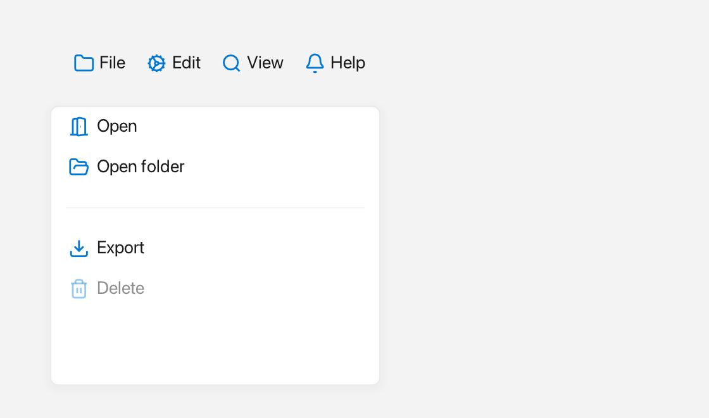

# Menu

A `Menu` is a list of items that can appear as a horizontal menu bar across the
top of a window or as a vertical dropdown list.



*A horizontal menu bar and a vertical dropdown.*

---

## What it's for

Use a `Menu` when you want to group actions for the user to pick from. A
horizontal menu bar is the familiar strip of names such as "File" and "Edit"; a
vertical menu is the list that opens below it or next to a button.

Each `Menu::Item` describes one entry. An item can show an icon, a plain
`label` or a rich `Inline` label, and a `shortcut`. Setting `separator` draws a
thin dividing line instead of an entry, and a `submenu` opens another menu to
the side. The `on_click` callback runs when the user picks the item, and
`enabled = false` greys it out.

An `Inline` is rich text built from plain text, an icon from `Icons::*`, and a
`Color`.

---

## A first example

A window is the operating-system window your app draws into. `Window::open`
creates it, and `if (!win)` stops the program if the window could not be opened.
`win.add<T>(...)` creates a widget inside that window and returns a
reference to it. `Rect{x, y, width, height}` places the widget.

```cpp
#include <memory>
#include <string>
#include <utility>
#include <vector>

#include <fluffy/fluffy.hpp>

int main() {
    fluffy::Window win = fluffy::Window::open("Menu demo", 640, 400);
    if (!win) return 1;

    auto& bar = win.add<fluffy::Menu>(
        fluffy::Rect{0, 0, 640, 32}, fluffy::Menu::Orientation::Horizontal);

    const std::pair<const char*, std::vector<const char*>> bars[] = {
        {"File", {"New", "Open...", "Save"}},
        {"Edit", {"Copy", "Paste"}},
        {"Help", {"Documentation", "About"}},
    };
    for (const auto& [title, entries] : bars) {
        fluffy::Menu::Item entry;
        entry.label = title;
        entry.submenu = std::make_unique<fluffy::Menu>(
            fluffy::Rect{}, fluffy::Menu::Orientation::Vertical);
        for (const char* name : entries) {
            fluffy::Menu::Item item;
            item.label = name;
            entry.submenu->addItem(std::move(item));
        }
        bar.addItem(std::move(entry));
    }

    auto& list = win.add<fluffy::Menu>(
        fluffy::Rect{16, 64, 240, 160}, fluffy::Menu::Orientation::Vertical);
    for (const char* name : {"New", "Open...", "Save", "Delete"}) {
        fluffy::Menu::Item item;
        item.label = name;
        list.addItem(std::move(item));
    }

    win.run();
}
```

`Menu::Orientation::Horizontal` makes a menu bar — each item owns a `submenu`
that opens when clicked. `Vertical` stacks the items as a dropdown list. Every
entry is a `Menu::Item`; here we set only its `label`, but an item can also
carry an `icon`, an `inlineLabel` (rich text that takes precedence over the
plain `label`), a `shortcut`, and an `on_click` callback. `addItem` adds the
finished item to the menu.

The snippets below assume `win` and `bar` from this example.

---

## Common tasks

### Add and clear items

```cpp
fluffy::Menu::Item it;
it.label = "Export as PDF";
bar.addItem(std::move(it));
bar.clearItems();

const auto& items = bar.items();
```

`addItem` adds one item at the end and `clearItems` removes them all. `items()`
returns the ordered entries as a `vector<Item>`.

### Switch between a bar and a dropdown

```cpp
bar.setOrientation(fluffy::Menu::Orientation::Vertical);
```

`Horizontal` lays the items out as a bar; `Vertical` stacks them as a dropdown
list.

### Open a menu as a popup

```cpp
auto popup = fluffy::Menu::makePopup(bar.items(), win);
win.showPopup(std::move(popup));
```

A popup is a floating menu drawn above the rest of the window; it closes when
the user clicks outside it or picks an item. `Menu::makePopup` builds one from a
menu's items, and `win.showPopup` takes ownership of it. `std::move` hands the
popup over to the window.

### Handle item clicks

```cpp
fluffy::Menu::Item it;
it.label = "Export as PDF";
it.on_click = [] { /* run the action */ };
```

There is no widget-level `onChange` for a menu. Each item has its own `on_click`
callback.

---

## Good to know

Menu items are built in code. A `Menu:` entry in YAML only sets the base widget
properties, so the menu starts empty.

---

## Quick reference

### Properties

| Property | Type | Description |
|---|---|---|
| `orientation` | `Horizontal` / `Vertical` | Layout direction. |
| `items` | `vector<Item>` | Ordered entries. |

### Item

`Item { icon, label, inlineLabel, shortcut, on_click, enabled, separator, submenu }`

- `icon`: `Icons::*` shown before the label.
- `label` / `inlineLabel`: plain or rich `Inline` (rich takes precedence).
- `separator`: `true` draws a thin line instead of an entry.
- `submenu`: `unique_ptr<Menu>` for cascading.

### Methods

```cpp
auto& bar = win.add<fluffy::Menu>(
    fluffy::Rect{0, 0, 640, 32}, fluffy::Menu::Orientation::Horizontal);
fluffy::Menu::Item it;
it.icon = fluffy::Icons::file_text;
it.label = "Export as PDF";
it.inlineLabel = fluffy::Inline{} << fluffy::Icons::star << " Star";
it.on_click = [] { };
it.enabled = true;
bar.addItem(std::move(it));
bar.clearItems();

bar.setOrientation(fluffy::Menu::Orientation::Vertical);
const auto& items = bar.items();

auto popup = fluffy::Menu::makePopup(bar.items(), win);
win.showPopup(std::move(popup));
```

### Events

| Event | Signature | When |
|---|---|---|
| `on_click` | `void()` | Per-`Item` click (wrapped with `closePopupDeferred()` in `makePopup`). |

No widget-level `onChange`; handle per-item.

---

## See also

- [ComboBox](combobox.md) — uses `Menu::makePopup`.
- [Button](button.md) — `setDropdownMenu`.
