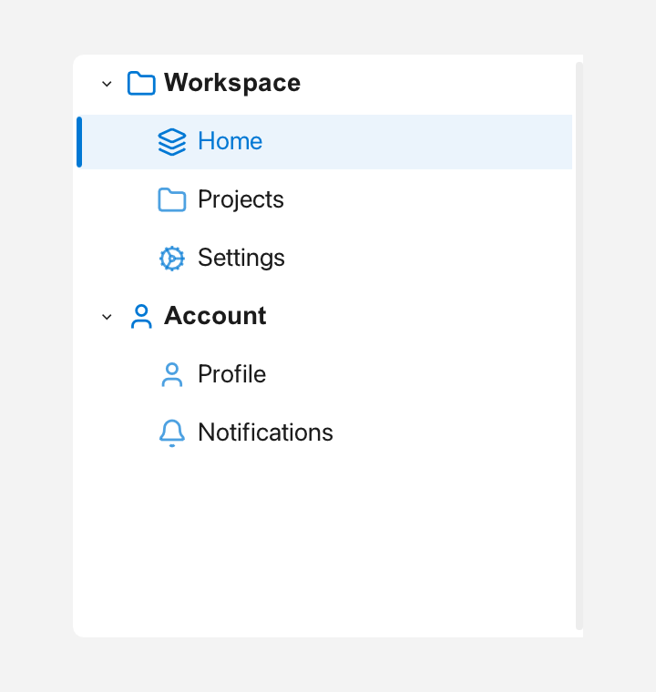

# Nav

`Nav` is a navigation sidebar: a vertical strip with expandable groups and
selectable items, whose right edge can be dragged to resize it.



*Expanded groups and a selected item.*

---

## What it's for

Use `Nav` when your app has several pages or sections and you want them listed
in a side panel, like the navigation pane of a settings app. Each group has a
`label`, an `icon`, and an `expanded` state, and holds items with an `icon`, a
`label`, and an `id`.

Clicking a group header expands or collapses it. Clicking an item selects it and
fires `onSelect`. Because you identify items by their string `id`, you can
select one from code without keeping track of row numbers.

---

## A first example

A window is the operating-system window your app draws into. `Window::open`
creates it, and `if (!win)` stops the program if the window could not be opened.
`win.add<T>(...)` creates a widget inside that window and returns a
reference to it. `Rect{x, y, width, height}` places the widget. A callback is a
small function you give to a widget so it can call you back when something
happens.

```cpp
#include <cstdio>
#include <utility>

#include <fluffy/fluffy.hpp>

int main() {
    fluffy::Window win = fluffy::Window::open("Nav demo", 800, 500);
    if (!win) return 1;

    auto& nav = win.add<fluffy::Nav>(fluffy::Rect{0, 0, 200, 500});

    fluffy::Nav::NavGroup g;
    g.label = "Display";
    g.id = "grp_display";
    g.icon = fluffy::Icons::monitor;

    fluffy::Nav::NavItem it;
    it.icon = fluffy::Icons::bookmark;
    it.label = "Label";
    it.id = "page_label";
    g.items.push_back(std::move(it));

    nav.addGroup(std::move(g));
    nav.setOnSelect([](const std::string& id) {
        std::printf("%s\n", id.c_str());
    });

    win.run();
}
```

You build a `NavGroup`, fill its `items` with `NavItem` values, then add the
group with `addGroup`. The item's `id` is the value you use later to select it.
The `onSelect` callback receives that `id` when the user clicks an item.

The snippets below assume `win` and `nav` from this example.

---

## Common tasks

### Add groups and root items

```cpp
nav.addGroup(std::move(g));
```

Groups are append-only through `addGroup`. If you need items that do not belong
to a group, add them directly:

```cpp
fluffy::Nav::NavItem home;
home.label = "Home";
home.id = "page_home";
nav.addItem(std::move(home));
```

### Select an item

```cpp
nav.setSelectedItem("page_label");

std::string id = nav.selectedItemId();
```

`setSelectedItem` selects an item by `id` and also fires `onSelect`. Read the
current `id` back with `selectedItemId()`.

### Expand and collapse groups

```cpp
nav.collapseAll();
nav.expandAll();
nav.expandGroup("grp_display");
nav.collapseGroup("grp_display");
```

`expandAll` and `collapseAll` change every group at once. `expandGroup` and
`collapseGroup` take a group `id` and change just that group. Groups start with
`expanded = true`.

### Resize the sidebar

```cpp
nav.setMinWidth(120.0f);
nav.computeMinWidth(win.theme(), win);
```

The right edge can be dragged to resize the sidebar. `setMinWidth` sets the
minimum width in pixels. `computeMinWidth` calculates a sensible minimum from
the current theme and window; the theme is the set of colors, fonts, and sizes
your app uses.

### React to selection and width changes

```cpp
nav.setOnSelect([](const std::string& id) {
    std::printf("%s\n", id.c_str());
});
nav.setOnWidthChange([](float w) { });
```

The `onSelect` callback receives the selected item's `id`. The `onWidthChange`
callback receives the new width while the user drags the edge.

---

## Good to know

`Nav` is built in code. A `Nav:` entry in YAML can set the initial `selected`
item id, but the groups and items themselves are added from C++.

---

## Quick reference

### Properties

| Property | Type | Description |
|---|---|---|
| `groups` | — | Ordered groups, append-only via `addGroup` (root items via `addItem`). |
| `selectedItem` | `string` | `id` of the current item (read via `selectedItemId()`, set via `setSelectedItem()` which also fires `onSelect`). |

### Group and item shapes

`NavGroup { label, id, icon, expanded = true, enabled, items: vector<NavItem> }`
`NavItem { icon, label, id, enabled, on_click }`

### Methods

```cpp
auto& nav = win.add<fluffy::Nav>(fluffy::Rect{0, 0, 200, 500});
fluffy::Nav::NavGroup g;
g.label = "Display";
g.id = "grp_display";
g.icon = fluffy::Icons::monitor;
fluffy::Nav::NavItem it;
it.icon = fluffy::Icons::bookmark;
it.label = "Label";
it.id = "page_label";
g.items.push_back(std::move(it));
nav.addGroup(std::move(g));

nav.setSelectedItem("page_label");
nav.collapseAll();
nav.expandAll();
nav.expandGroup("grp_display");
nav.collapseGroup("grp_display");
nav.setMinWidth(120.0f);
nav.computeMinWidth(win.theme(), win);
std::string id = nav.selectedItemId();
```

### Events

| Event | Signature | When |
|---|---|---|
| `onSelect` | `void(const string& id)` | Item click. |
| `onWidthChange` | `void(float width)` | Drag resize. |

```cpp
nav.setOnSelect([](const std::string& id) {
    std::printf("%s\n", id.c_str());
});
nav.setOnWidthChange([](float w) { });
```

---

## See also

- [Menu](menu.md)
