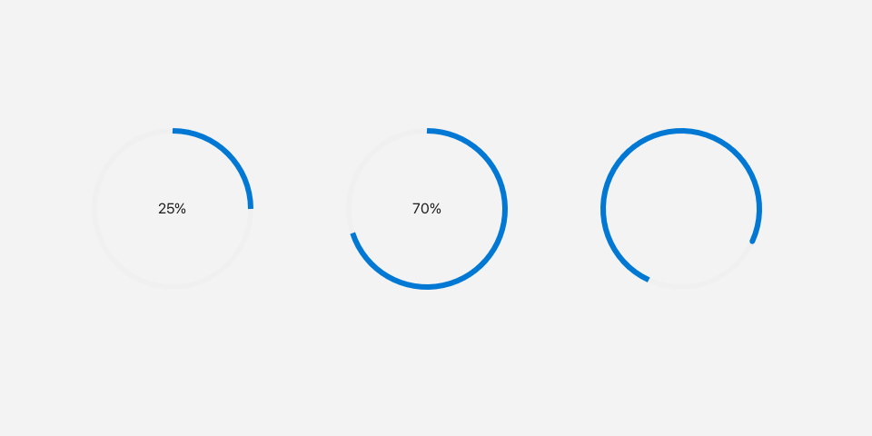

# ProgressRing

A `ProgressRing` shows progress as a circular ring, either filling in
proportion to a value or spinning to show that work is happening.



*Determinate rings and an indeterminate spinner.*

---

## What it's for

Use a `ProgressRing` when you need a compact, non-interactive indicator. It is
purely informational: the user cannot click or drag it.

There are two modes. In determinate mode the ring fills clockwise in proportion
to a `value` between `0` and `1`, and a percentage label appears in the center.
In indeterminate mode the ring draws a rotating arc instead, which is useful
when you do not know how long the work will take.

---

## A first example

A window is the operating-system window your app draws into. `Window::open`
creates it, and `if (!win)` stops the program if the window could not be opened.
`win.add<T>(...)` creates a widget inside that window and returns a
reference to it. `Rect{x, y, width, height}` places the widget.

```cpp
#include <fluffy/fluffy.hpp>

int main() {
    fluffy::Window win = fluffy::Window::open("ProgressRing demo", 640, 400);
    if (!win) return 1;

    auto& p1 = win.add<fluffy::ProgressRing>(fluffy::Rect{40, 40, 48, 48}, -1.0f);
    auto& p2 = win.add<fluffy::ProgressRing>(fluffy::Rect{100, 40, 48, 48}, 0.65f);

    win.run();
}
```

The second constructor argument is the initial value. A negative value such as
`-1.0f` gives an indeterminate spinner; a value from `0` to `1` gives
determinate progress. Here `p2` shows 65%.

The snippets below assume `win`, `p1`, and `p2` from this example.

---

## Common tasks

### Switching modes

```cpp
p1.setValue(0.5f);
p1.setIndeterminate(true);
```

`setValue` maps values below `-0.5` to `-1` and clamps the rest to `[0, 1]`.
`setIndeterminate(false)` resets the value to `0.0` and returns to determinate
mode.

### Checking the current value

```cpp
float v = p1.value();
bool ind = p1.value() < 0;
```

A `value()` below `0` means the ring is indeterminate; there is no
`isIndeterminate()` getter.

### Loading from YAML

Fluffy can also describe widgets in YAML, a plain text format:

```yaml
ProgressRing:
  value: 0.5
  indeterminate: false
  x: 40
  y: 40
  width: 48
  height: 48
```

---

## Good to know

- The constructor default is `-1.0f`, so a `ProgressRing` starts as an
  indeterminate spinner unless you pass a value.
- `ProgressRing` has no events.

---

## Quick reference

### Properties

| Property | Type | Description |
|---|---|---|
| `value` | `float` | `value() < 0` = indeterminate (constructor default `-1.0f`), otherwise `0..1`. `setValue` maps below `-0.5` to `-1` and clamps the rest to `[0,1]`; `setIndeterminate(false)` resets to `0.0`. |

### Methods

```cpp
auto& p1 = win.add<fluffy::ProgressRing>(fluffy::Rect{40, 40, 48, 48}, -1.0f);
auto& p2 = win.add<fluffy::ProgressRing>(fluffy::Rect{100, 40, 48, 48}, 0.65f);

p1.setValue(0.5f);
p1.setIndeterminate(true);
float v = p1.value();
bool ind = p1.value() < 0;
```

### Events

None.

---

## See also

- [Slider](slider.md) — interactive progress.
