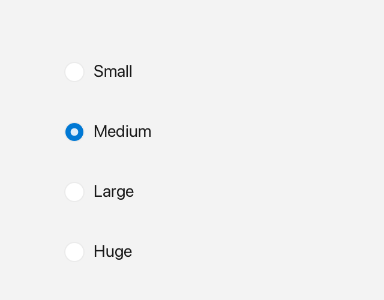

# RadioButton

A `RadioButton` is a circular indicator with a label; buttons sharing the same `group` are mutually exclusive.



*One selected option in an exclusive group.*

## What it's for

A radio button is an **exclusive choice** control: it is a circle with a label, and it can be either checked or unchecked. The useful part is the group. Radio buttons that share the same group name are linked, and only one of them can be checked at a time.

When the user checks one button in a group, Fluffy automatically unchecks the button that was checked before. Clicking the already checked button leaves it checked, because a group is meant to always have exactly one selected option.

Use radio buttons when the user must pick exactly one option from a set, such as a size or a shipping method. If the choices are independent, use a [Checkbox](checkbox.md) instead.

A group is just a string. Two buttons belong to the same group when their group names match exactly. A button whose group name is empty is independent.

## A first example

```cpp
#include <cstdio>

#include <fluffy/fluffy.hpp>

int main() {
    fluffy::Window win = fluffy::Window::open("Radio buttons", 640, 400);
    if (!win) return 1;

    auto& small = win.add<fluffy::RadioButton>(
        fluffy::Rect{40, 40, 120, 28}, "Small");
    small.setGroup("size");
    small.setChecked(true);

    auto& medium = win.add<fluffy::RadioButton>(
        fluffy::Rect{40, 80, 120, 28}, "Medium");
    medium.setGroup("size");

    win.run();
}
```

`Window::open` creates the window, and `if (!win)` stops early if it could not be opened. `win.add<fluffy::RadioButton>()` creates a radio button inside the window and returns a reference to it. The `auto&` matters: `small` and `medium` are those references, so you work with the real buttons rather than copies.

The first constructor argument is a `Rect` that sets the position and size. The second is the text label. Both buttons call `setGroup("size")`, so they belong to the same exclusive set. Set the group before checking a button: `small.setChecked(true)` then checks `small`, and checking `medium` later will uncheck `small`.

## Common tasks

### Read the group and state

```cpp
std::string g = small.group();
bool on = small.isChecked();
```

`group()` returns the group name and `isChecked()` tells you whether the circle is filled.

### Change the label or disable the button

```cpp
small.setLabel("New text");
small.setEnabled(false);
```

`setLabel()` replaces the text to the right of the circle. Passing `false` to `setEnabled()` greys out the button and makes it ignore input.

### React to changes

A **callback** is a function you give to a widget so it can call you back when something happens. `onChange` is the radio button's callback for its state changing:

```cpp
medium.setOnChange([](bool checked) {
    std::printf("medium checked: %d\n", checked);
});
```

The callback runs when the user clicks the button, and also when you call `setChecked(true)` yourself. It receives the new boolean state. When a group changes, the newly checked button gets `true` and the button that was unchecked gets `false`, so attach a callback to each button whose state you care about.

### Declare it in YAML

```yaml
RadioButton:
  label: "Medium"
  group: "size"
  checked: false
  x: 40
  y: 80
```

`label` is the text beside the circle, `group` is the shared group name, `checked` is the initial state, and `x` / `y` place it. Add `width` and `height` when you want to set the size too.

## Quick reference

### Properties

| Property | Type | Description |
|---|---|---|
| `label` | `string` | Text to the right of the circle. |
| `group` | `string` | Group name. Empty means independent. |
| `checked` | `bool` | Whether the dot is shown. |
| `enabled` | `bool` | Inherited. |

### Events

| Event | Signature | When |
|---|---|---|
| `onChange` | `void(bool checked)` | Fires for the newly checked button and for the peer that was unchecked — via click or programmatically via `setChecked(true)`. |

## See also

- [Checkbox](checkbox.md) — independent toggle.
- [Switch](switch.md)
