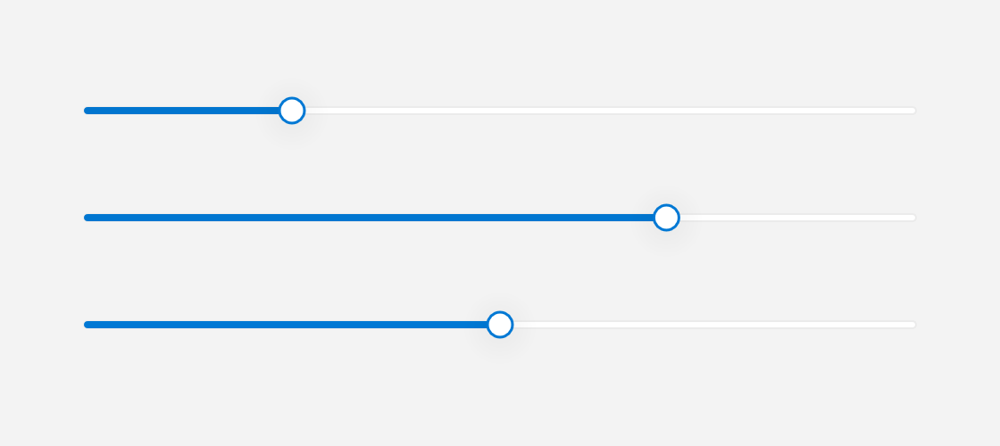

# Slider

A `Slider` lets you pick a floating-point value by dragging a thumb along a horizontal track.



*Several values, plus a disabled slider.*

## What it's for

A slider lets the user choose a number from a continuous range. The **value** is the current number. The **range** is the lowest and highest number the slider allows, written as `min` and `max`. By default the range is `0..1`.

The widget shows a horizontal track with a thumb on it. Dragging the thumb updates the value continuously, and clicking elsewhere on the track jumps straight to that position. The value is always kept inside the range.

Use a slider for values where the exact number matters less than the general position, such as volume, brightness, or a percentage. You can also show the current value as formatted text above the thumb.

## A first example

```cpp
#include <cstdio>

#include <fluffy/fluffy.hpp>

int main() {
    fluffy::Window win = fluffy::Window::open("Slider", 640, 400);
    if (!win) return 1;

    auto& sl = win.add<fluffy::Slider>(
        fluffy::Rect{40, 40, 300, 32}, 0.5f);
    sl.setRange(0.0f, 100.0f);
    sl.setValue(42.0f);

    float v = sl.value();
    float lo = sl.minValue();
    float hi = sl.maxValue();
    std::printf("value %.1f in [%.1f, %.1f]\n", v, lo, hi);

    win.run();
}
```

`Window::open` creates the window, and `if (!win)` stops early if it could not be opened. `win.add<fluffy::Slider>()` creates the slider inside the window and returns a reference to it. The `auto&` matters: `sl` is that reference, so you work with the real slider rather than a copy.

The first constructor argument is a `Rect` that sets the position and size. The second is the initial value, `0.5f`. `setRange(0.0f, 100.0f)` changes the allowed range, and `setValue(42.0f)` moves the thumb to 42. `value()` reads the current number, while `minValue()` and `maxValue()` read the ends of the range.

## Common tasks

### Show the current value

```cpp
sl.setShowValue(true);
sl.setValueFormat("{:.1f} units");
std::string fmt = sl.valueFormat();
```

`setShowValue(true)` turns on the value text above the thumb. It is off by default.

`setValueFormat()` takes a format pattern. In `"{:.1f}"`, `1` means one digit after the decimal point, so `42` displays as `42.0`. You can put text around the number, as in `"{:.1f} units"`. The default pattern is `"{:.2f}"`. `valueFormat()` returns the current pattern.

### Change the range

```cpp
sl.setRange(0.0f, 100.0f);
```

`setRange(min, max)` sets both ends of the range. If the current value falls outside the new range, it is clamped to the nearest end. Keep the lower number first.

### Disable the slider

```cpp
sl.setEnabled(false);
```

Passing `false` to `setEnabled()` greys out the slider and makes it ignore input. The `focused` property is the standard widget focus state.

### React to changes

A **callback** is a function you give to a widget so it can call you back when something happens. `onChange` is the slider's callback for its value changing:

```cpp
sl.setOnChange([](float v) {
    std::printf("%.1f\n", v);
});
```

The callback runs while the user drags the thumb and when they click the track. It receives the current value as a `float`. This is mouse-only; there is no keyboard control.

### Declare it in YAML

```yaml
Slider:
  value: 0.5
  min: 0
  max: 1
  show_value: true
  value_format: "{:.2f}"
  x: 40
  y: 40
  width: 300
```

`value` is the current number, `min` and `max` are the range ends, `show_value` turns the value text on or off, and `value_format` is the format pattern. `x`, `y`, and `width` set the geometry.

## Quick reference

### Properties

| Property | Type | Description |
|---|---|---|
| `value` | `float` | Current position in `min..max`. Clamped. |
| `min` / `max` | `float` | Range ends. Default `0..1`. |
| `showValue` | `bool` | Whether to render the formatted value. |
| `valueFormat` | `string` | `fmt` pattern, e.g. `"{:.1f} units"`. |
| `enabled` / `focused` | `bool` | Standard `Widget` focus. |

### Events

| Event | Signature | When |
|---|---|---|
| `onChange` | `void(float value)` | While dragging or track-clicking (mouse only — no keyboard control). |

## See also

- [ProgressRing](progress_ring.md) — read-only progress.
