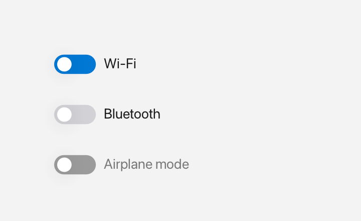

# Switch

A `Switch` is a pill-shaped on/off toggle with a sliding thumb and an optional label.



*On, off and disabled.*

## What it's for

A switch is an **on/off control**, just like a checkbox: it has two states, on and off. The difference is visual. A switch looks like a physical toggle with a thumb that slides to the right when it is on, while a checkbox uses a square and a checkmark.

Use a switch for a setting whose effect is immediate, such as "Wi-Fi" or "Airplane mode". Use a [Checkbox](checkbox.md) when the user is opting into something or when you want the choice to look like a checklist item. Both are independent controls, so checking one does not affect another.

Clicking anywhere on the switch toggles it. There is no keyboard activation yet. The thumb slide is animated automatically.

## A first example

```cpp
#include <cstdio>

#include <fluffy/fluffy.hpp>

int main() {
    fluffy::Window win = fluffy::Window::open("Switch", 640, 400);
    if (!win) return 1;

    auto& sw = win.add<fluffy::Switch>(
        fluffy::Rect{40, 40, 140, 28}, "Wi-Fi");
    sw.setChecked(true);

    bool on = sw.isChecked();
    std::printf("Wi-Fi on: %d\n", on);

    win.run();
}
```

`Window::open` creates the window, and `if (!win)` stops early if it could not be opened. `win.add<fluffy::Switch>()` creates the switch inside the window and returns a reference to it. The `auto&` matters: `sw` is that reference, so you work with the real switch rather than a copy.

The first constructor argument is a `Rect` that sets the position and size. The second is the optional label, which appears next to the pill. `setChecked(true)` turns the switch on, and `isChecked()` reads the current state.

## Common tasks

### Change the label

```cpp
sw.setLabel("Bluetooth");
```

`setLabel()` replaces the text next to the pill.

### Disable or focus the switch

```cpp
sw.setEnabled(false);
sw.setFocused(true);
```

When `false` is passed to `setEnabled()`, the switch is greyed out and ignores input. `setFocused(true)` gives it keyboard focus, which shows a focus ring; it still does not toggle from the keyboard.

### React to changes

A **callback** is a function you give to a widget so it can call you back when something happens. `onChange` is the switch's callback for its state changing:

```cpp
sw.setOnChange([](bool on) {
    std::printf("Wi-Fi on: %d\n", on);
});
```

The callback runs when the user clicks the switch, and also when you call `setChecked()` yourself. It receives `true` when the switch is on and `false` when it is off. `setChecked()` only calls the callback when the value actually changes.

### Declare it in YAML

```yaml
Switch:
  label: "Airplane"
  checked: false
  x: 40
  y: 40
```

`label` is the text next to the pill, `checked` is the initial state, and `x` / `y` place it. Add `width` and `height` when you want to set the size too.

## Quick reference

### Properties

| Property | Type | Description |
|---|---|---|
| `label` | `string` | Text next to the pill. |
| `checked` | `bool` | `true` = on (thumb right, accent). |
| `enabled` | `bool` | Greyed out when `false`. |

### Events

| Event | Signature | When |
|---|---|---|
| `onChange` | `void(bool checked)` | Click toggle, or programmatically via `setChecked()`. |

## See also

- [Checkbox](checkbox.md) · [RadioButton](radiobutton.md)
