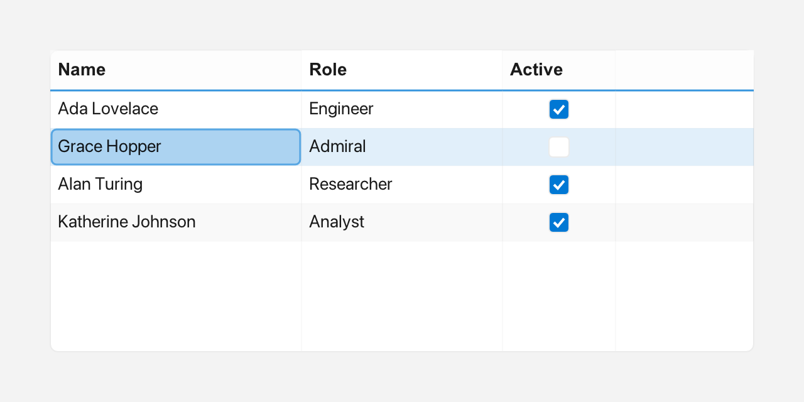

# Table

A `Table` is an editable grid with a header row and scrollable rows. Cells can
hold plain text, a drop-down choice, or a boolean checkbox, and may include
`Inline` glyphs.



*Column headers, rows and a selected cell.*

---

## What it's for

Use a `Table` when your data has several columns and the user needs to read or
edit it in place. A [ListView](listview.md) is better for a single column of
choices; a `Table` is better for records such as a list of people with a name,
an active flag, and a city.

Each column is described by a `Table::Column`: its `label`, its `width`, whether
it is `editable`, its `kind`, an optional rich header (`headerInline`), and, for
choice columns, the list of `choices`. The `kind` decides how a cell behaves:

- `Kind::Text` — plain text, edited with a text field.
- `Kind::Choice` — a value picked from a short drop-down list.
- `Kind::Bool` — a checkbox that toggles on a click.

An `Inline` is rich text built from plain text, an icon from `Icons::*`, and a
`Color`. Use it for header glyphs or colored cell content.

---

## A first example

A window is the operating-system window your app draws into. `Window::open`
creates it, and `if (!win)` stops the program if the window could not be opened.
`win.add<T>(...)` creates a widget inside that window and returns a
reference to it. `Rect{x, y, width, height}` places the widget. A callback is a
small function you give to a widget so it can call you back when something
happens.

```cpp
#include <cstdio>
#include <vector>

#include <fluffy/fluffy.hpp>

int main() {
    fluffy::Window win = fluffy::Window::open("Table demo", 720, 400);
    if (!win) return 1;

    auto& tbl = win.add<fluffy::Table>(fluffy::Rect{40, 40, 470, 220});

    std::vector<fluffy::Table::Column> cols = {
        {"Name", 160, true, fluffy::Table::Column::Kind::Text},
        {"Active", 70, true, fluffy::Table::Column::Kind::Bool},
        {"City", 140, true, fluffy::Table::Column::Kind::Choice}
    };
    cols[2].choices = {"Paris", "London", "Berlin"};
    tbl.setColumns(cols);
    tbl.setHeader(0, fluffy::Inline{} << fluffy::Icons::user << " Name");
    tbl.setHeaderBackground(fluffy::Color::fromHex(0xFF4A6FA5));

    tbl.setRows({{"Alice", "true", "Paris"}, {"Bob", "false", "London"}});

    tbl.onSelect([](int r, int c) { });
    tbl.onCellChange([](int r, int c, const std::string& v) { });

    win.run();
}
```

You describe the columns first, including any `choices` for `Choice` columns,
and pass them to `setColumns`. Then `setRows` fills the grid; each inner list is
one row, with one string per column. `onSelect` and `onCellChange` register
callbacks: the first tells you when the selected cell changes, and the second
when an edited cell is committed.

The snippets below assume `win` and `tbl` from this example.

---

## Common tasks

### Styling the header and rows

```cpp
tbl.setHeader(0, fluffy::Inline{} << fluffy::Icons::user << " Name");
tbl.setHeaderBackground(fluffy::Color::fromHex(0xFF4A6FA5));
```

Use `setHeaderBackground`, `setHeaderTextColor`, and `setHeaderFont` for the
header. Row striping and cell text use `setCellBackground`,
`setCellBackgroundAlt`, `setCellTextColor`, and `setCellFont`.

### Adding and editing cells

```cpp
tbl.setRowsInline({{fluffy::Inline{} << fluffy::Icons::star << " Alice"}});
tbl.addRow({"Carol", "true", "Berlin"});
tbl.addRowInline({fluffy::Inline{} << "Dave"});

tbl.setCell(0, 0, "New");
tbl.setCellInline(0, 0, fluffy::Inline{} << fluffy::Color{200, 40, 40, 255} << "Red");
std::string v = tbl.cell(0, 0);
fluffy::Inline inl = tbl.cellInline(0, 0);
```

`setRows` replaces all the data, while `addRow` and `addRowInline` add a row at
the end, padded to the column count. The row data is write-only: there is no
`rows()` getter, so read values through `cell()`, `cellInline()`, or
`rowCount()`.

### Selecting a cell

```cpp
tbl.setSelected(1, 0);
int r = tbl.selectedRow();
int c = tbl.selectedCol();
int rc = tbl.rowCount();
int cc = tbl.columnCount();
```

`selectedRow` and `selectedCol` are `-1` when nothing is selected.
`setSelected(row, col = 0)` sets the current cell; an out-of-range row or column
is silently ignored.

### Starting an edit programmatically

```cpp
tbl.beginEdit(0, 0, win);
```

This opens the editor for a cell as if the user had started editing it.

### Loading columns from YAML

Fluffy can also describe widgets in YAML, a plain text format:

```yaml
Table:
  columns: ["Name", "Active", "Age", "City"]
```

`columns` also accepts a comma-separated scalar. Rows are set in code; a `rows:`
key in YAML is silently ignored.

---

## Good to know

- `Column { label, width = 120, editable = true, kind = Text, headerInline, choices }`.
- `setColumns` replaces all columns and resizes existing rows; `addColumn`
  appends one and fills `headerInline` from `label`.
- Editing depends on the column kind: `Text` opens an inline `TextInput` on
  double-click or `Enter`, and `Enter` commits; `Choice` opens an embedded
  `ComboBox` popup on double-click; `Bool` toggles on a single click and is
  drawn as a 16px rounded checkbox.
- `Arrow` and `Tab` move the selection, and typing starts editing the selected
  cell.
- `onCellChange` fires when a cell is committed by text submit, choice pick, or
  bool toggle.

---

## Quick reference

### Properties

| Property | Type | Description |
|---|---|---|
| `columns` | `vector<Column>` | Headers and widths. `setColumns` replaces all columns and resizes existing rows; `addColumn` appends one (auto-inits `headerInline` from `label`). |
| `rows` | — | Cell data, write-only: `setRows` / `setRowsInline` / `addRow` / `addRowInline` (padded to column count). There is no `rows()` getter — read via `cell()` / `cellInline()` / `rowCount()`. |
| `selectedRow` / `selectedCol` | `int` | Current cell (`-1` none, read via `selectedRow()` / `selectedCol()`). Set with `setSelected(row, col=0)` — out-of-range row or column is a silent no-op. |
| `setHeaderBackground` / `setHeaderTextColor` / `setHeaderFont` | setters | Header styling. |
| `setCellBackground` / `setCellBackgroundAlt` / `setCellTextColor` / `setCellFont` | setters | Row striping and text styling. |

`Column { label, width=120, editable=true, kind=Text, headerInline, choices }`.

### Methods

```cpp
auto& tbl = win.add<fluffy::Table>(fluffy::Rect{40, 40, 470, 220});
std::vector<fluffy::Table::Column> cols = {
    {"Name", 160, true, fluffy::Table::Column::Kind::Text},
    {"Active", 70, true, fluffy::Table::Column::Kind::Bool},
    {"City", 140, true, fluffy::Table::Column::Kind::Choice}
};
cols[2].choices = {"Paris", "London", "Berlin"};
tbl.setColumns(cols);
tbl.setHeader(0, fluffy::Inline{} << fluffy::Icons::user << " Name");
tbl.setHeaderBackground(fluffy::Color::fromHex(0xFF4A6FA5));

tbl.setRows({{"Alice", "true", "Paris"}, {"Bob", "false", "London"}});
tbl.setRowsInline({{fluffy::Inline{} << fluffy::Icons::star << " Alice"}});
tbl.addRow({"Carol", "true", "Berlin"});
tbl.addRowInline({fluffy::Inline{} << "Dave"});

tbl.setCell(0, 0, "New");
tbl.setCellInline(0, 0, fluffy::Inline{} << fluffy::Color{200, 40, 40, 255} << "Red");
std::string v = tbl.cell(0, 0);
fluffy::Inline inl = tbl.cellInline(0, 0);

tbl.setSelected(1, 0);
int r = tbl.selectedRow();
int c = tbl.selectedCol();
int rc = tbl.rowCount();
int cc = tbl.columnCount();
```

### Editing

| Kind | Interaction |
|---|---|
| `Text` | Double-click or `Enter` opens an inline `TextInput`; `Enter` commits. |
| `Choice` | Double-click opens an embedded `ComboBox` popup. |
| `Bool` | Single click toggles `true/false` (drawn as 16px rounded checkbox). |

`Arrow`/`Tab` moves selection; typing starts editing the selected cell.

### Events

| Event | Signature | When |
|---|---|---|
| `onSelect` | `void(int row, int col)` | Selection changes. |
| `onCellChange` | `void(int row, int col, const string& value)` | Cell committed (text submit, choice pick, bool toggle). |

```cpp
tbl.onSelect([](int r, int c) { });
tbl.onCellChange([](int r, int c, const std::string& v) { });
```

---

## See also

- [ComboBox](combobox.md) — used for `Choice` cells.
- [Inline](inline.md)
