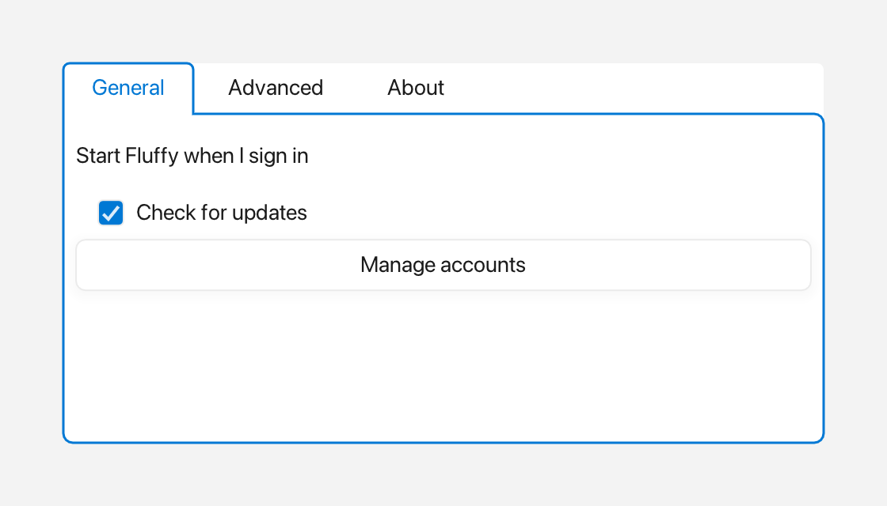

# TabView

A `TabView` shows a row of tabs above a content panel. Only the selected tab's
panel is visible.



*Three tabs, with the first one active.*

---

## What it's for

Use a `TabView` when you want to split a window into several pages that the user
switches between, such as "Overview", "Details", and "Settings". Tabs keep each
page one click away without giving every page its own window.

The widget draws the tab buttons along the top and a content area below. The
selected tab's text uses the theme's accent color, and hovering another tab
gives it a subtle fill. When the tab view has focus, a halo surrounds the panel
and the selected tab as one shape.

---

## A first example

A window is the operating-system window your app draws into. `Window::open`
creates it, and `if (!win)` stops the program if the window could not be opened.
`win.add<T>(...)` creates a widget inside that window and returns a
reference to it. `Rect{x, y, width, height}` places the widget. A callback is a
small function you give to a widget so it can call you back when something
happens.

```cpp
#include <cstdio>

#include <fluffy/fluffy.hpp>

int main() {
    fluffy::Window win = fluffy::Window::open("TabView demo", 640, 400);
    if (!win) return 1;

    auto& tv = win.add<fluffy::TabView>(fluffy::Rect{40, 40, 400, 200});
    tv.addTab("Overview", "overview");
    tv.addTab("Details", "details");
    tv.addTab("Settings", "settings");

    tv.setSelected(1);
    tv.setOnSelect([](int idx, const std::string& id) {
        std::printf("tab %d:%s\n", idx, id.c_str());
    });

    win.run();
}
```

`addTab(label, id)` adds a tab in order. The first tab is selected
automatically; later `addTab` calls leave the selection alone. `setSelected`
changes the visible tab, and the `onSelect` callback tells you when the
selection changes, giving you the index and the tab's `id`.

The snippets below assume `win` and `tv` from this example.

---

## Common tasks

### Putting widgets in a tab

A `Container` is a widget that holds other widgets. The active tab's content
lives in the `Container` returned by `content()`. `add` on that container
works the same way as `add` on the window.

```cpp
auto& content = *tv.content();
auto& label = content.add<fluffy::Label>(fluffy::Rect{8, 8, 200, 24}, "Hello");
content.removeAllChildren();
```

`removeAllChildren` clears the active tab's content. The window still owns the
container, so you do not delete it yourself.

### Loading from YAML

Fluffy can also describe widgets in YAML, a plain text format:

```yaml
TabView:
  tabs: ["Overview", "Details", "Settings"]
  selected: 0
  x: 40
  y: 40
  width: 400
  height: 200
```

`TabView` reads only `tabs` and `selected` from YAML; the geometry keys shown
here are ignored, so set the bounds in code with `setBounds`.

---

## Good to know

- Tabs are append-only through `addTab`. There is no `tabs()` getter and no
  remove or clear operation.
- `setSelected` does nothing for out-of-range indices or for the already-selected
  index; neither case fires `onSelect`.
- `addTab` with an empty `id` uses `label` as the `id`.
- The first tab (`selected == 0`) already shows its highlight at first view.

---

## Quick reference

### Properties

| Property | Type | Description |
|---|---|---|
| `tabs` | — | Ordered headers, append-only via `addTab(label, id)` (no `tabs()` getter, no remove/clear). |
| `selected` | `int` | Index of the visible tab (read via `selected()`). The first `addTab` selects `0`; later `addTab` calls leave the selection alone. |
| `content` | `Container*` | Container for the active tab's widgets. |

### Methods

```cpp
auto& tv = win.add<fluffy::TabView>(fluffy::Rect{40, 40, 400, 200});
tv.addTab("Overview", "overview");
tv.addTab("Details", "details");
tv.addTab("Settings", "settings");

tv.setSelected(1);
int sel = tv.selected();

tv.setOnSelect([](int idx, const std::string& id) {
    std::printf("tab %d:%s\n", idx, id.c_str());
});

auto& content = *tv.content();
auto& label = content.add<fluffy::Label>(fluffy::Rect{8, 8, 200, 24}, "Hello");
content.removeAllChildren();
```

### Events

| Event | Signature | When |
|---|---|---|
| `onSelect` | `void(int index, const string& id)` | Click on a header tab or programmatic `setSelected()` with a new, in-range index. |

---

## See also

- [Container](container.md) — `tv.content()` is a `Container`.
