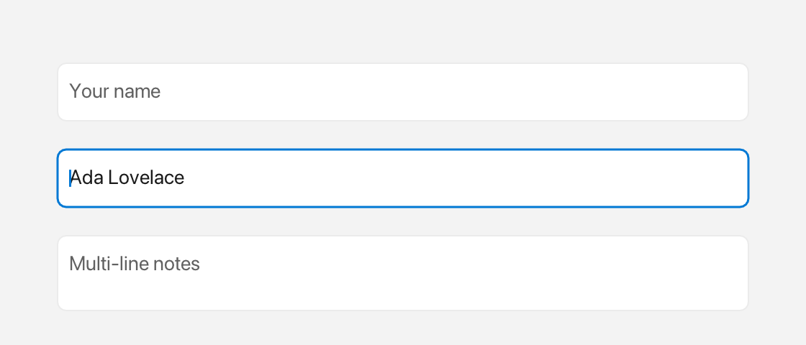

# TextInput

A `TextInput` is an editable field for single-line or multi-line text that supports selection, clipboard, undo/redo, and a non-editable prefix.



*Placeholder, focused input and a multi-line field.*

## What it's for

Use a `TextInput` when the user needs to enter or edit text. It edits `text` with a blinking cursor and selection highlight, shows a `placeholder` when empty and unfocused, and can keep a `prefix` (for example `Icons::search`) fixed at the left so it cannot be edited.

## The words you need

- **placeholder** — greyed-out hint text shown while the field is empty and not focused.
- **`Inline`** — rich content that can mix text and icons. The `$()` shorthand builds it. See [Inline](inline.md) and [Icons](icons.md).
- **callback** — a small function the field calls when something happens, such as a change or a submit.

In the examples below, `win` is an open window (see [Window](window.md)).

## A first example

```cpp
// Constructor argument is the placeholder, not initial text (bounds default to Rect{}):
auto& ti = win.add<fluffy::TextInput>("Type here…");
ti.setBounds(fluffy::Rect{40, 40, 300, 36});
ti.setText("Hello");
std::string t = ti.text();
```

The constructor argument is the placeholder, not the initial text: the field starts empty and shows "Type here…" until you type. Bounds default to `Rect{}`, so set them with `setBounds`. `setText` replaces the content, and `text()` returns what is currently there.

## Common tasks

### Set and read the text

```cpp
ti.setText("Hello"); // replaces content, resets cursor/selection/undo history
std::string t = ti.text();
```

`setText` resets the cursor, the selection, and the undo history.

### Show a placeholder and a prefix

```cpp
ti.setPlaceholder("Search…");
ti.setPrefix(fluffy::$(fluffy::Icons::search << " "));
```

The placeholder appears when `text` is empty and the field is not focused. The prefix is fixed at the left and is not editable.

### Use multiline mode and handle submit

```cpp
ti.setMultiline(true);
bool m = ti.isMultiline();
```

When `multiline` is `true`, `Enter` inserts a newline; when it is `false`, `Enter` fires `onSubmit`. The default is `false`.

### Control growth and scrolling

```cpp
ti.setGrowable(false);          // default is growable == true
bool g = ti.growable();

// Manual scroll (usually handled via ensureCursorVisible)
float sx = ti.scrollX(), sy = ti.scrollY();
ti.scrollToX(0); ti.scrollToY(0);
```

If `growable` is `true`, `naturalWidth` and `naturalHeight` grow with the content.

### Focus the field

```cpp
ti.setFocused(true);            // focusing via click is automatic
bool f = ti.isFocused();        // blurring clears the selection
```

A click focuses the field automatically. Blurring clears the selection.

### Listen for changes and submits

```cpp
ti.onChange([](const std::string& s){ }); // preferred; setOnChange/setOnSubmit also work
ti.onSubmit([](const std::string& s){ std::printf("submit %s\n", s.c_str()); });
```

`onChange` runs after every insertion or deletion. `onSubmit` runs when you press `Enter` in single-line mode.

### Load a text input from YAML

```yaml
TextInput:
  placeholder: "Type here…"
  text: "Hello"
  multiline: false
  growable: true
  x: 40
  y: 40
  width: 300
  height: 36
  onSubmit: "submitted"
```

## Keyboard

`← →` move, `Shift+← →` select, `Up/Down` move between lines (multiline, keeps visual column), double-click selects a word, drag extends the selection. `Ctrl+A` all, `Ctrl+C/V/X` clipboard, `Ctrl+Z` / `Ctrl+Shift+Z` / `Ctrl+Y` undo/redo, `Home/End`, `Backspace/Delete`, `Tab` inserts 4 spaces in multiline mode only.

## Good to know

- `focused` is set automatically on click and controls whether the field receives keyboard input.
- The constructor argument is the placeholder, not the initial text.
- `multiline` defaults to `false`.
- `growable` defaults to `true`.

## Quick reference

### Properties

| Property | Type | Description |
|---|---|---|
| `text` | `string` | Current content. |
| `placeholder` | `string` | Hint shown when `text` empty and not focused. |
| `prefix` | `Inline` | Fixed icon+text at left (e.g. `$(Icons::search << " ")`). |
| `multiline` | `bool` | `true` makes `Enter` insert newline; `false` fires `onSubmit`. Default `false`. |
| `growable` | `bool` | If `true`, `naturalWidth/Height` grow with content. |
| `focused` | `bool` | Whether it receives keyboard input. Set automatically on click. |

### Methods

```cpp
// Constructor argument is the placeholder, not initial text (bounds default to Rect{}):
auto& ti = win.add<fluffy::TextInput>("Type here…");
ti.setBounds(fluffy::Rect{40, 40, 300, 36});
ti.setText("Hello");            // replaces content, resets cursor/selection/undo history
std::string t = ti.text();

ti.setPlaceholder("Search…");
ti.setPrefix(fluffy::$(fluffy::Icons::search << " "));
ti.setMultiline(true);
bool m = ti.isMultiline();
ti.setGrowable(false);          // default is growable == true
bool g = ti.growable();

// Manual scroll (usually handled via ensureCursorVisible)
float sx = ti.scrollX(), sy = ti.scrollY();
ti.scrollToX(0); ti.scrollToY(0);

ti.setFocused(true);            // focusing via click is automatic
bool f = ti.isFocused();        // blurring clears the selection
```

### Events

| Event | Signature | When |
|---|---|---|
| `onChange` | `void(const string& text)` | After every insertion/deletion. |
| `onSubmit` | `void(const string& text)` | `Enter` in single-line mode. |

```cpp
ti.onChange([](const std::string& s){ }); // preferred; setOnChange/setOnSubmit also work
ti.onSubmit([](const std::string& s){ std::printf("submit %s\n", s.c_str()); });
```

## See also

- [Inline](inline.md) — prefix uses `Inline`.
- [Widget](widget.md)
