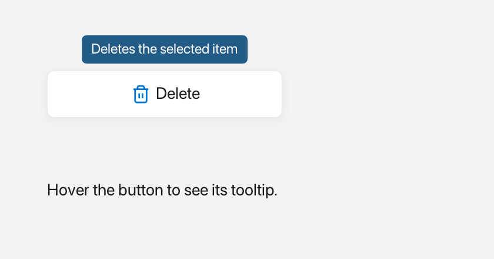

# Tooltip

A `Tooltip` is a small popup bubble that appears when the user hovers over a
widget and hides itself after a short delay.



*A tooltip above the button that owns it.*

---

## What it's for

Use a `Tooltip` to explain a control or show a short hint without using
permanent space in the window. It is perfect for icon buttons and compact
toolbars where a full label would not fit.

The bubble is rounded and appears near the widget the user is hovering. It
supports plain text or rich `Inline` content with icons and colors. A tooltip
appears after about half a second of hovering and fades away after a couple of
seconds. Moving the pointer away only stops it from appearing again; a bubble
that is already visible finishes its own timer.

An `Inline` is rich text built from plain text, an icon from `Icons::*`, and a
`Color`.

---

## A first example

A window is the operating-system window your app draws into. `Window::open`
creates it, and `if (!win)` stops the program if the window could not be opened.
`win.add<T>(...)` creates a widget inside that window and returns a
reference to it. `Rect{x, y, width, height}` places the widget.

```cpp
#include <fluffy/fluffy.hpp>

int main() {
    fluffy::Window win = fluffy::Window::open("Tooltip demo", 640, 400);
    if (!win) return 1;

    auto& btn = win.add<fluffy::Button>("Hover me");
    btn.setBounds(fluffy::Rect{40, 40, 140, 40});

    fluffy::setTooltip(&btn, "Hello!");

    win.run();
}
```

`setTooltip` attaches a hover tooltip to a widget. It expects a pointer, so you
pass `&btn`; `btn` itself is a reference to the button. Hover over the button
and the bubble appears.

The snippets below assume `win` and `btn` from this example.

---

## Common tasks

### Use rich content

Pass an `Inline` instead of a plain string when you want an icon or colored
text:

```cpp
fluffy::setTooltip(&btn, fluffy::Inline{} << fluffy::Icons::badge_info << " Tip");
```

### Show a tooltip programmatically

```cpp
fluffy::Tooltip::showFor(&btn, "Hello", win);
fluffy::Tooltip::showFor(&btn, fluffy::Inline{} << fluffy::Icons::heart << " Hi", win);
```

Call `showFor` when you want to show the bubble without waiting for hover. The
two overloads mirror the text forms: one takes a plain string and one takes an
`Inline`. Like `setTooltip`, `showFor` expects a pointer to the widget that the
bubble should follow.

### Create and update a tooltip widget

Most of the time `setTooltip` is all you need. If you want to manage a tooltip
yourself, create one like any other widget and update its content:

```cpp
auto& tip = win.add<fluffy::Tooltip>(fluffy::Rect{0, 0, 120, 22}, "text");
tip.setText("new text");
tip.setInline(fluffy::Inline{} << fluffy::Icons::star << " Star");
```

`setText` replaces the rich content with plain text. `setInline` rebuilds the
plain text from the `Inline` text runs.

### Size the bubble

`naturalWidth` and `naturalHeight` measure the content so the bubble can be
sized correctly.

---

## Good to know

- There are no `text()` or `inline()` getters.
- The auto-hide delay is fixed at about 2.5 seconds, and the bubble height is
  24 logical pixels.
- There are no events. While the window runs, Fluffy checks hovered widgets
  about every half second and shows the attached tooltip when one is found.
- A `Tooltip:` entry in YAML creates an empty tooltip with only the base widget
  properties. Hover text is still attached in code with `setTooltip`.

---

## Quick reference

### Properties

| Property | Type | Description |
|---|---|---|
| `text` | `string` | Plain bubble text. `setText` overwrites the rich content. |
| `inline` | `Inline` | Rich bubble (`Color` + `Icons::*`). `setInline` rebuilds the plain text from its `Text` runs. |

Two constructors (`Tooltip(Rect, string)` / `Tooltip(Rect, Inline)`) and two `showFor` overloads (same shapes). There are no `text()` / `inline()` getters; the auto-hide delay is fixed at `2.5s` and the height at `24.0f`.

### Methods

```cpp
fluffy::setTooltip(&btn, "Hello!");
fluffy::setTooltip(&btn, fluffy::Inline{} << fluffy::Icons::badge_info << " Tip");

fluffy::Tooltip::showFor(&btn, "Hello", win);
fluffy::Tooltip::showFor(&btn, fluffy::Inline{} << fluffy::Icons::heart << " Hi", win);

auto& tip = win.add<fluffy::Tooltip>(fluffy::Rect{0, 0, 120, 22}, "text");
tip.setText("new text");
tip.setInline(fluffy::Inline{} << fluffy::Icons::star << " Star");
```

`naturalWidth` / `naturalHeight` measure `Inline` runs for correct bubble size.

### Events

None. While the window runs, Fluffy checks hovered widgets about every half second and shows the attached tooltip when one is found.

---

## See also

- [Inline](inline.md) · [Icons](icons.md)
