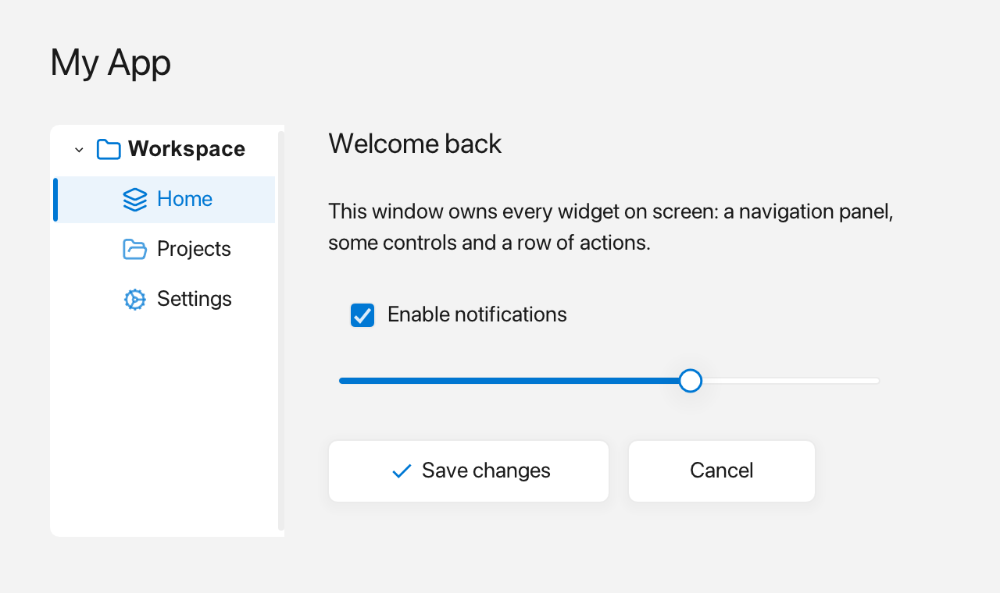

# Window

A `fluffy::Window` is the top-level operating-system window you see on screen; it owns all widgets and runs the event loop.



*A window holding a small application layout.*

## What it's for

Use a `Window` as the root of every Fluffy app. It creates the native window, holds your widget tree, and pumps the events that keep the interface responsive. You add widgets to it, place them, give them callbacks, and then run it.

## A first example

```cpp
#include <fluffy/fluffy.hpp>

int main() {
    fluffy::Window win = fluffy::Window::open("Hello", 640, 400);
    if (!win) return 1;

    win.run();  // blocks until the window closes
    return 0;
}
```

`Window::open` takes a title and a size in pixels, and gives you the window. Opening can fail — for example, if the machine has no display — so check `if (!win)`: when the window is usable the condition is false and the program continues, otherwise we return.

`open` is the convenient path for everyday code. If you need to choose every creation setting, use `Window::create(Config)` instead. It takes a `Config` value and returns a `Result<Window>`: a small box holding either the window or an error message. Check the result before using the value:

```cpp
auto result = fluffy::Window::create({.title = "My App",
                                      .width = 640,
                                      .height = 400,
                                      .resizable = false});
if (!result) {
    std::printf("Could not open window: %s\n", result.error().c_str());
    return 1;
}
fluffy::Window& win = result.value();
```

`result.value()` gives you the window on success; `result.error()` gives you the message on failure. If a failure leaves you with nothing sensible to do, `result.unwrap()` returns the window on success and otherwise prints the error and stops the program — use it only when there is truly no way to continue. In everyday code, prefer `open` and `if (!win)`.

## Common tasks

### Create a window and add widgets

```cpp
fluffy::Window win = fluffy::Window::open("My App", 800, 600);
if (!win) return 1;

auto& label = win.add<fluffy::Label>("Hello, World!");
label.setBounds(fluffy::Rect{40, 40, 200, 32});

auto& btn = win.add<fluffy::Button>("Click me");
btn.setBounds(fluffy::Rect{40, 120, 120, 40});

btn.onClick([] {
    std::printf("Clicked!\n");
});

win.run();
```

Use `add<T>()` to create a widget attached to the window. It returns a reference to the widget the window now owns, so the reference stays valid while the window is alive and you never delete the widget yourself. Bounds default to `Rect{}`, so plain `add<Label>("Hello")` just works and you place it with `setBounds`:

```cpp
auto& label = win.add<fluffy::Label>("Hello");
auto& btn   = win.add<fluffy::Button>("OK");
auto& input = win.add<fluffy::TextInput>("Type here…");
```

To adopt an existing widget tree:

```cpp
auto container = std::make_unique<fluffy::Container>(rect);
fluffy::Widget* raw = win.adopt(std::move(container)); // returns the owned pointer
```

`win.widgetCount()` and `win.rootWidget(i)` let you inspect the roots. For a full-window container with a layout, use a helper instead of manual `Rect`s:

```cpp
auto& col = win.verticalLayout();    // root Container + VerticalLayout
auto& row = win.horizontalLayout();  // same root, horizontal variant
auto& grid = win.gridLayout(3);      // same root, GridLayout with 3 columns
```

The helpers create the root container on the first call and return it afterwards. Because they share one root, call the one you want first; a later call cannot change the orientation it already has.

### Run one window or several

`win.run()` starts the event loop and blocks until the window closes. Each pass of the loop:

1. Reads keyboard/mouse events.
2. Updates animations and cursor blink.
3. Draws everything.
4. Repeats until the window closes.

The loop exits when the user closes the window or when you call `win.requestClose()`. For a single window this is all you need. If more than one `Window` exists, `win.run()` delegates to the application-wide loop, `Application::get().run()`.

For multiple windows, use the static lazy `Application`:

```cpp
#include <fluffy/application.hpp>
#include <fluffy/fluffy.hpp>
fluffy::Window w1 = fluffy::Window::open("A", 800, 600);
fluffy::Window w2 = fluffy::Window::open("B", 640, 400);
if (!w1 || !w2) return 1;
w2.setTheme(fluffy::Theme::defaultDark()); // per-window Theme kept
w1.verticalLayout().add<fluffy::Label>("Hello");
fluffy::Application::get().run(); // pumps all windows
// or manual: while(fluffy::Application::get().update(1/60.f)) {}
// update() with no arg computes dt; update(dt) returns bool continue
```

Every `Window` registers itself with `Application::get()` on successful creation or move, and unregisters when it is destroyed. Use `Application::get().windowCount()` and `window(i)` to list the windows, `Window::isAlive()` to know whether one is still alive, and `Application::quit()` to end the loop. Closing one window hides it, and the loop keeps running while any window is alive. See [Application](application.md).

### Capture a screenshot

`win.saveScreenshot("shot.png")` writes the window's current framebuffer to a PNG file. It does not draw a frame itself, so render one first:

```cpp
fluffy::Window win = fluffy::Window::open("My App", 800, 600);
if (!win) return 1;

// Add widgets, then draw the frame you want to capture.
win.renderFrame();

if (!win.saveScreenshot("shot.png")) {
    std::fprintf(stderr, "Could not save screenshot\n");
}
```

The method returns `false` if the framebuffer is unavailable or the file cannot be written. It also returns `false` on WebAssembly, where screenshot capture is not supported. PNG encoding is built in through `stb_image_write`, so no external image library is required.

For off-screen captures, create the window with `visible = false`, call `renderFrame()`, then call `saveScreenshot()`. This is how the documentation screenshots are generated.

### Change themes and fonts

You can change the theme at runtime:

```cpp
win.setTheme(fluffy::Theme::defaultDark());
```

A `Theme` bundles the colors, spacing, and fonts the window uses; each window keeps its own. You can register a custom font from memory:

```cpp
win.registerFontMemory("Inter", ttf_data, ttf_data_size);
fluffy::Theme t = fluffy::Theme::defaultLight();
t.font_family = "Inter";
win.setTheme(t);
```

Widgets accept four font-spec formats via `setFont()`, described in the font-spec table in Quick reference. See [Theme](theme.md) for colors, fonts, and metrics.

### Show dialogs and wire events

Show a modal dialog and get the clicked button:

```cpp
auto answer = win.showDialog("Confirm", "Are you sure?", {"Yes", "No"});

if (answer == fluffy::Window::DialogChoice::First) {
    // proceed
}
```

Preset button sets and rich `Inline` labels use the same typed answer (see [Dialogs](dialog.md)):

```cpp
auto preset = win.showDialog("Title", "Message", fluffy::Window::DialogButtons::YesNo);
auto custom = win.showDialog("Title", fluffy::Inline{} << "Message",
                             {fluffy::Inline{} << "OK"});
```

You can register named handlers and wire them from YAML:

```cpp
win.dispatcher().registerHandler("save", [](const fluffy::EventArgument&) {
    std::printf("Saving…\n");
});
```

See [YAML](yaml.md) for how to bind widgets to these handlers.

### Control title-bar buttons and use helpers

Disable specific title-bar buttons:

```cpp
win.setEnabledButtons(fluffy::WindowButtons::Close);
```

The default is all buttons enabled. Fluffy uses this internally to prevent closing a parent window while a dialog is open.

Other common window operations include moving keyboard focus and loading a UI from YAML:

```cpp
win.requestFocus(w);
win.clearFocus();

if (!win.load("ui.yaml")) {
    // handle failure
}
```

## Good to know

- On WebAssembly there is no second native window: `showDialog` falls back to `alert`/`confirm` and returns `DialogChoice::First` for 3+ buttons.
- `verticalLayout()`, `horizontalLayout()`, and `gridLayout()` share one root container: the first call creates it and later calls return it. Pick the orientation you want the first time.
- Setting `visible` to `false` keeps the window initially hidden, which is useful for off-screen `renderFrame`/`saveScreenshot` before showing.
- `Window::open` leaves an object whose `run()` does nothing on failure, so always check `if (!win)`.
- In multi-window apps, closing one window hides it and the loop continues while any window is alive.

## Quick reference

### Config options

| Field | Type | Default | Meaning |
|---|---|---|---|
| `title` | `std::string` | `"Fluffy"` | Title bar text |
| `width` | `int` | `800` | Initial width in logical pixels |
| `height` | `int` | `600` | Initial height in logical pixels |
| `min_width` | `int` | `0` | Minimum width (`0` = no minimum) |
| `min_height` | `int` | `0` | Minimum height (`0` = no minimum) |
| `resizable` | `bool` | `true` | User can resize |
| `vsync` | `bool` | `true` | Wait for monitor refresh |
| `visible` | `bool` | `true` | `false` = initially hidden (useful for off-screen `renderFrame`/`saveScreenshot` before showing) |
| `decorated` | `bool` | `true` | `false` = borderless (custom chrome) |
| `theme` | `Theme` | light theme | Per-window starting colors and fonts |

### Font specs

| Spec | Example | Behavior |
|---|---|---|
| Family name | `"Inter"` | Resolved via `findSystemFont` at runtime |
| `"file:"` path | `"file:/path/to/font.ttf"` | Loaded directly from disk |
| Bare file path | `"/path/to/font.ttf"` | Auto-detected by `.ttf`/`.ttc`/`.otf` extension |
| `"mem:"` handle | `"mem:body"` | Pre-registered via `registerFontMemory`, or lazy-loaded from disk on first use |

### Useful helpers

- `win.cursorPosition(x, y)` / `win.setCursorPosition(x, y)` — read or drive the cached mouse position.
- `win.setCursorShape(fluffy::CursorShape::IBeam)` — change the cursor (a `CursorShape` value).
- `win.getClipboardString()` / `win.setClipboardString(...)` — clipboard access.
- `win.load("ui.yaml")` / `win.loadFromString(yaml)` — load a UI from a file or string. Both return `NoneResult`; check it. See [YAML](yaml.md).
- `win.close()` / `win.requestClose()` — exit the main loop.
- `win.setOnResize([](int w, int h) { })` — resize callback; `win.designSize()` — current logical size.
- `win.onKey([](int key, int mods) { return false; })` / `win.onClose([] { return false; })` — simple key/close hooks without raw `Event` plumbing.
- `win.setEventHandler(h)` / `win.clearEventHandler()` — intercept every event before widgets see it (advanced).
- `win.requestFocus(w)` / `win.clearFocus()` — move keyboard focus.
- `win.showPopup(p)` / `win.closePopup()` / `win.closePopupDeferred()` / `win.hasPopup()` / `win.popup()` — popup overlay stack (menus, tooltips, combo lists).
- `win.saveScreenshot("shot.png")` — write the current framebuffer to a PNG; returns `false` on failure or WebAssembly.
- `win.nativeHandle()` — `NSWindow*` (macOS), `HWND` (Windows), X11 `Window`, or `nullptr` on WebAssembly. Needed by `WebView`.
- `win.loadSystemFont("Helvetica")` / `win.prepareFont(vg, spec, out)` / `win.nvgContext()` — font and NanoVG access.

## See also

- [Widget](widget.md) — what every widget can do.
- [Theme](theme.md) — colors, fonts, and metrics.
- [Dialogs](dialog.md) — modal dialogs.
- [YAML](yaml.md) — declarative UI.
